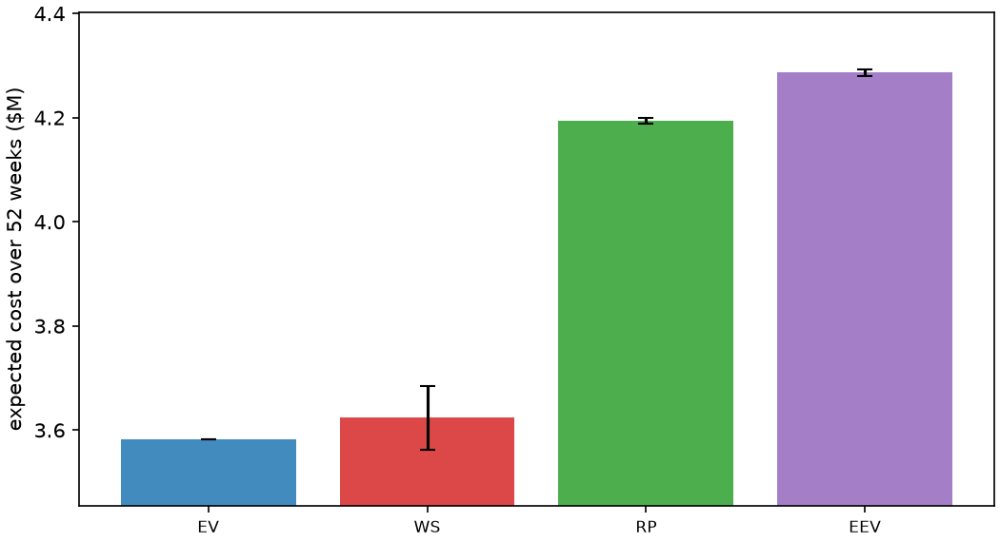

# Maintenance scheduling under uncertain utilization

[](https://github.com/GMCavalheri/fractional-ownership-maintenance-scheduling/actions/workflows/ci.yml)
[](https://github.com/GMCavalheri/fractional-ownership-maintenance-scheduling/actions/workflows/reproduce.yml)

An airline can plan maintenance against a timetable. A business jet in a fractional-ownership
programme has none: its owners fly when they choose, and one aircraft's year ranges from 350
to 1200 flight hours around the 800 the programme sells. Components wear with flight hours,
so a maintenance plan written in calendar weeks has to guess when each task falls due. This
repository measures what planning for the average costs, and how much is recovered by:
- a plan optimised across many sampled futures;
- an exact solution of that problem;
- re-planning as the hours come in.

The core is `fracsched`, a typed Python package. It builds on two earlier projects, reused
unchanged through pinned git tags: the genetic algorithm and exact CP-SAT model of
[AVR-04](https://github.com/GMCavalheri/Preventive-Maintenance-Optimization-with-Genetic-Algorithms),
and the Bayesian failure-rate model of
[EJD-01](https://github.com/GMCavalheri/bayesian-small-fleet-reliability). It comes with a
nine-lesson course that derives every method.



## Headline results (synthetic fleet, stated assumptions)

Utilization regimes, costs and capacities are illustrative and labelled; the 800 hours a year
and the 1/16 minimum share come from public sources. Every number is reproduced by
`validation/run_all.py`, and CI fails if one changes.

| question | answer | where |
|---|---|---|
| How uncertain is a fractional jet's year? | One aircraft: 353 to 1219 FH (P1 to P99) around 800. A 600 FH task falls due between week 29 and week 57 (P10 to P90), against 39 at mean use | [Lesson 1](docs/lessons/01-flying-hours-you-cant-predict.md) |
| What does planning for the average cost? | AVR-04's plan, reproduced exactly at the mean, promises 3.58 \$M a year and costs 4.29 \$M on 10 000 futures (+20 %), mostly through forced tasks | [Lesson 2](docs/lessons/02-planning-for-the-average.md) |
| Does a plan that sees the futures help? | A sample-average plan saves 2.2 % on average and 0.23 \$M in the P99 year; a worst-case plan overfits its sample | [Lesson 3](docs/lessons/03-planning-for-many-futures.md) |
| Is the genetic algorithm good enough? | Its best of three runs is within 0.24 % of the proven optimum (CP-SAT, small instances); the SAA plan is within 4 % of the true optimum at 95 % confidence | [Lessons 4](docs/lessons/04-the-exact-answer-for-a-sampled-future.md), [8](docs/lessons/08-the-price-of-planning-for-the-average.md) |
| Where does the overrun go? | Not to variability: with perfect foresight the plans would cost about the promise. 0.57 of the 0.71 \$M is the value of information; a single robust plan recovers 0.09 | [Lesson 8](docs/lessons/08-the-price-of-planning-for-the-average.md) |
| What recovers more? | Re-planning every four weeks from the observed hours: −8 to −9 %, cheaper in all 48 simulated years | [Lesson 5](docs/lessons/05-re-planning-as-the-hours-come-in.md) |
| Do owner contracts tame the hours? | They cap the fleet (CV 0.10 → 0.07), not an aircraft (0.23 → 0.22) | [Lesson 6](docs/lessons/06-who-owns-the-hours.md) |
| Does uncertain wear matter? | Less than uncertain hours (cost sd 0.22 against 0.64 \$M), and barely for an expected-cost plan; plugging in the mean Weibull scale understates cost by 2 % | [Lesson 7](docs/lessons/07-uncertain-wear-on-top-of-uncertain-hours.md) |

The full write-up is the [report](docs/report.md). What is and is not new is in
[related work](docs/related-work.md): the methods are established, robust and look-ahead
scheduling of airline heavy checks under uncertain utilization already exists, and the
contribution is a measurement for fractional fleets, stated narrowly.

## Modules

| module | phase | what it does |
|---|---|---|
| [`utilization_model`](docs/utilization_model.md) | 1 | weekly hours: season × fleet demand × Markov-modulated Gamma; closed-form moments; conditional sampling |
| [`problem`, `scenarios`](docs/scenarios.md) | 2 | AVR-04's instance on a flight-hour clock; forced tasks as recourse; segment cost tables |
| [`deterministic_baseline`](docs/deterministic_baseline.md) | 2 | AVR-04's GA and fixed-interval rules at the mean |
| [`robust_scenario_scheduling`](docs/robust_scenario_scheduling.md) | 3 | AVR-04's GA with a sample-average fitness (mean, CVaR, worst case) and a scenario best response |
| [`exact_saa`](docs/exact_saa.md) | extra | the sample-average problem as AVR-04's DAG integer program, solved by CP-SAT |
| [`dynamic_rescheduling`](docs/dynamic_rescheduling.md) | 4 | rolling-horizon re-planning from the observed state |
| [`contracts`](docs/contracts.md) | extra | owners' shares, allocations, borrowing and caps |
| [`bayesian_risk`](docs/bayesian_risk.md) | extra | a posterior Weibull wear multiplier from EJD-01's conjugate update |
| [`tradeoff`](docs/tradeoff.md), [`risk_measures`](docs/risk_measures.md) | 5 | EV, EEV, RP, WS, VSS, EVPI, Mak-Morton-Wood; CVaR and summaries |

## Quickstart

```bash
uv sync
```

```bash
uv run pytest --cov
```

```bash
uv run python validation/run_all.py
```

`run_all.py` regenerates every table in `validation/results/` and every figure in
`docs/figures/` (about an hour on a 12-core machine; `-m "not slow"` makes the tests quick).
`notebooks/` holds one executed demo per lesson, rebuilt by `notebooks/build_notebooks.py`.

```python
from fracsched.problem import main_problem
from fracsched.robust_scenario_scheduling import RobustConfig, run_robust_ga
from fracsched.scenarios import cost_table
from fracsched.utilization_model import default_model
import numpy as np

problem = main_problem()  # AVR-04's 10 x 4 x 52 case on the flight-hour clock
u, _ = default_model().sample(np.random.default_rng(0), 100, 10, 52)
plan = run_robust_ga(problem, cost_table(problem, u), RobustConfig(objective="cvar")).schedule
```

## Course

[Nine lessons](docs/lessons/README.md), one per phase or extra, each with derivations, a code
walkthrough, a worked example, exercises with solutions and references.

## Engineering

* **Reuse, not copies.** AVR-04 (`pmo`) and EJD-01 (`smallfleet`) are git dependencies pinned to
  their `v1.0.0` tags; at the mean the FH problem *is* AVR-04's, and a test holds it to that.
* **Tests against oracles.** Every test compares with a closed form, an independent
  implementation (a week-by-week simulator, path enumeration, quadrature), brute force over
  every feasible plan, AVR-04's own evaluator and exact model, or Monte Carlo within stated
  standard errors. Hypothesis checks properties such as WS ≤ RP ≤ EEV and CVaR bounds.
  Coverage ≥ 90 %, strict mypy, ruff.
* **Reproducible.** Seeded generators throughout; GA fitness rounded to cents so CPUs cannot
  disagree on a tournament; CP-SAT single-threaded for every reported optimum. A separate
  workflow reruns every validation script and diffs the results byte for byte; the one
  documented exception is a time-limited main-instance CP-SAT run.
* **CI** on Python 3.11 to 3.13, plus gitleaks and pip-audit.

## Deviations from the plan

* The PLAN's `external/` copy of the GA became a pinned dependency on AVR-04's `pmo` v1.0.0.
  That tag was added to AVR-04 for this purpose; AVR-04's own package metadata still says
  0.1.0.
* AVR-04 counts age in weeks; here age is flight hours, with calendar limits 50 % longer than
  the FH limits at mean use. The deterministic baseline maps back exactly.
* The planning freeze is the four weeks between re-plans, not two weeks inside a monthly cycle,
  so AVR-04's decoder needs no notion of a fixed task.
* The main-instance exact solve is time-limited; exact optima are proven on AVR-04's small
  instances.

## License

[MIT](LICENSE) © 2026 Gabriel Milanez Cavalheri
