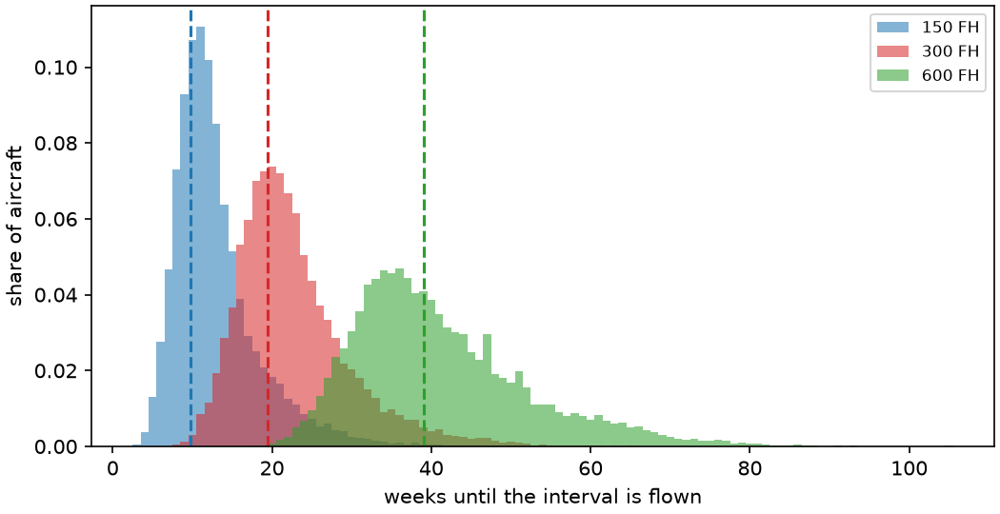

# Lesson 1 · Flying hours you can't predict

> A maintenance plan is a promise about the future: this component will be serviced in that
> week. For an airliner the promise is easy to keep, because next month's flying is in the
> timetable. A business jet in a fractional-ownership fleet has no timetable. Its owners call
> with a few hours' notice, and some months they do not call at all. This lesson builds the
> model of that uncertainty that every later lesson plans against. It then measures the one
> consequence that matters for maintenance: how many calendar weeks a flight-hour interval
> actually lasts.

**Code:** [`src/fracsched/utilization_model/`](../../src/fracsched/utilization_model/) ·
**Tests:** [`tests/test_utilization_model.py`](../../tests/test_utilization_model.py) ·
**Results:** [`validation/results/utilization.md`](../../validation/results/utilization.md) ·
**Next:** [Lesson 2](02-planning-for-the-average.md)

## Learning objectives

By the end of this lesson you should be able to:

1. Explain why a fractional-ownership aircraft's utilization is uncertain, and why that
   matters for components whose wear is counted in flight hours.
2. Build a Markov-modulated (regime-switching) model of weekly flight hours with a shared
   fleet factor and a seasonal cycle.
3. Derive its mean, variance, autocorrelation, cross-aircraft correlation and the variance of
   an annual total in closed form.
4. Explain why week-to-week persistence, not week-to-week noise, drives the uncertainty in a
   year's hours.
5. Compute the distribution of the calendar time an interval of $L$ flight hours lasts, and
   explain why it is not $L/\bar u$.

---

## 1. Why the hours are uncertain

**Fractional ownership.** In a fractional programme, an owner buys a share of an aircraft
together with a yearly allowance of flight hours. The public programme pages describe a
1/16 share as 50 hours a year, and larger shares in multiples of it, so one whole aircraft is
sold as about **800 hours a year** (Flexjet). Owners do not fly "their" aircraft: the operator
dispatches any aircraft of the type from a pooled fleet, at short notice. Industry data put
the average fractional aircraft at 779 hours in 2025, against roughly 140 for corporate and
private aircraft (WingX data quoted by McKinsey, 2026). Fractional aircraft fly a lot, and
how much depends on what owners decide this week.

**Why maintenance cares.** Maintenance programmes state task intervals in flight hours (FH),
cycles or calendar time, often "whichever comes first". A task due every 600 FH falls due in
the week the aircraft reaches 600 FH, and that week is unknown in advance. A plan written in
calendar weeks has to guess it. Lesson 2 shows what happens when the guess is the average.

**What this project models.** The time grid is the week, as in AVR-04, the project this one
extends. Each aircraft flies $u_{a,t}$ hours in week $t$. A component's age is the sum of
its aircraft's hours since its last task. Everything else (costs, failures, the GA) is
AVR-04's, rebuilt on that FH clock.

> **How the project is built.** The PLAN asked for an `external/` copy of AVR-04's genetic
> algorithm. Instead, AVR-04's package `pmo` is a dependency pinned to its git tag v1.0.0, so
> its code is reused unchanged and never duplicated. EJD-01's `smallfleet` is pinned the same
> way (Lesson 7). AVR-04 counted age in calendar weeks; this project counts it in flight
> hours, and Lesson 2 shows that the two agree exactly when utilization is constant.

## 2. The model

Aircraft $a$ flies, in week $t$,

```math
u_{a,t} = m_t \, D_t \, X_{a,t}, \qquad D_t = e^{Z_t - s^2/2}, \qquad Z_t = \phi Z_{t-1} + \sigma \varepsilon_t ,
```

capped at 70 FH, about ten hours a day every day. Three factors:

* **Season** $m_t$, a fixed multiplier with mean 1 over the year: a cosine cycle peaking in
  mid-July, $\pm 15\%$, with a 30 % uplift in the Thanksgiving week and the two year-end
  weeks.
* **Fleet demand** $D_t$, shared by every aircraft: a lognormal AR(1). With
  $\varepsilon_t \sim N(0,1)$ the stationary variance of $Z$ is $s^2 = \sigma^2/(1-\phi^2)$, and the
  $-s^2/2$ term makes $E[D_t] = 1$. Here $\phi = 0.8$ and $\sigma = 0.12$, so $s = 0.2$.
* **The aircraft's own demand** $X_{a,t}$: a regime $R_{a,t} \in$ {idle, normal, spike}
  follows a Markov chain with transition matrix $P$. Given the regime $r$, the hours are
  Gamma with mean $\mu_r$ and shape $k_r$. Different aircraft have independent chains.

```math
P = \begin{pmatrix} 0.85 & 0.15 & 0 \\ 0.04 & 0.88 & 0.08 \\ 0 & 0.35 & 0.65 \end{pmatrix}, \qquad \mu \propto (0.15, 1, 2), \qquad k = (1, 4, 6) .
```

The idle regime is an owner away or an aircraft held for one customer: a few repositioning
hours a week, lasting $1/(1 - 0.85) = 6.7$ weeks on average. A spike is a burst of long
trips, about 30 FH a week, lasting 2.9 weeks. Every value is an illustrative assumption
labelled in
[`utilization_parameters.csv`](../../src/fracsched/data/utilization_parameters.csv), except one:
the $\mu_r$ are scaled so that the mean is exactly 800 FH a year.

This is a *regime-switching* model, the same idea Hamilton (1989) used for business cycles:
a hidden state that persists, and data whose distribution depends on it. It is simple, and
it has every feature that matters here: persistence, bursts, quiet spells, a common shock
and a season.

## 3. Moments in closed form

### The regime chain

The stationary distribution $\pi$ solves $\pi P = \pi$ with $\sum_r \pi_r = 1$. Here the chain
is a birth-death chain, so detailed balance gives it directly:
$0.15\pi_{\text{idle}} = 0.04\pi_{\text{normal}}$ and $0.08\pi_{\text{normal}} = 0.35\pi_{\text{spike}}$, so

```math
\pi = (0.1783, \; 0.6688, \; 0.1529) .
```

### An aircraft's own hours

By the law of total expectation over the regime, and the Gamma moments
$E[X \mid r] = \mu_r$ and $E[X^2 \mid r] = \mu_r^2 (1 + 1/k_r)$:

```math
E[X] = \sum_r \pi_r \mu_r, \qquad E[X^2] = \sum_r \pi_r \mu_r^2\left(1 + \frac{1}{k_r}\right), \qquad E[X_t X_{t+h}] = \sum_{r, r'} \pi_r \, (P^h)_{r r'} \, \mu_r \mu_{r'} \quad (h \ge 1).
```

The last formula is where persistence enters: given the regime $r$ now, the regime $h$ weeks
later is distributed as row $r$ of $P^h$, and the Gamma noise of different weeks is
independent given the regimes.

### The fleet factor

$Z_t$ and $Z_{t+h}$ are jointly normal with variance $s^2$ and covariance $s^2\phi^h$. Since
$E[e^{W}] = e^{\text{Var}(W)/2}$ for a centred normal $W$,

```math
E[D_t D_{t+h}] = E\left[e^{Z_t + Z_{t+h} - s^2}\right] = e^{(2s^2 + 2s^2\phi^h)/2 - s^2} = e^{s^2 \phi^h} .
```

### Putting them together

$D$ and $X$ are independent, so every second moment of $u$ is a product:

```math
\text{Cov}(u_{a,t}, u_{a,t'}) = m_t m_{t'} \left( E[D_t D_{t'}] \, E[X_t X_{t'}] - E[X]^2 \right), \qquad \text{Cov}(u_{a,t}, u_{b,t'}) = m_t m_{t'} E[X]^2 \left( E[D_t D_{t'}] - 1 \right) \quad (a \ne b).
```

A year's hours $Y_a = \sum_t u_{a,t}$ have variance equal to the sum of the whole $52 \times 52$
covariance matrix. A fleet of $n$ aircraft adds $n(n-1)$ copies of the cross-aircraft matrix.
These are the functions in
[`moments.py`](../../src/fracsched/utilization_model/moments.py). The tests check them three
independent ways:
* the lagged moment by summing over every regime path;
* the fleet factor by two-dimensional Gauss-Hermite quadrature;
* everything by Monte Carlo, within four standard errors.

## 4. What the numbers say

From [`validation/results/utilization.md`](../../validation/results/utilization.md):

| statistic | value |
|---|---|
| mean FH per aircraft-year | 800 |
| sd of a de-seasonalised week | 12.08 FH |
| sd of a year **if weeks were independent** | 87.6 FH |
| sd of a year (the model) | 186.2 FH (CV 0.23) |
| lag-1, lag-4, lag-13 autocorrelation | 0.40, 0.19, 0.03 |
| correlation of two aircraft in one week | 0.066 |
| CV of a 10-aircraft fleet's year | 0.106 |
| one aircraft's year, P1 to P99 (capped) | 353 to 1219 FH |

Two things to take away.

**Persistence, not noise, makes a year uncertain.** A single week varies a lot (sd 12 FH
around a mean of 15). If weeks were independent, 52 of them would average out to an annual sd
of 88 FH. The regimes make weeks move together: an idle spell removes several weeks at once.
That more than doubles the annual sd, to 186 FH. A planner who estimates variability from
weekly scatter, and assumes independence, underestimates a year's uncertainty by half.

**A fleet is more predictable than any aircraft in it.** The fleet's CV (0.106) is less than
half an aircraft's (0.23), but not $0.23/\sqrt{10} = 0.074$: the shared demand factor does
not average out. The fleet total is fairly predictable. The single aircraft, whose components
are the ones due, is not.

## 5. How long does an FH interval last?

A task due every $L$ FH falls due in the first week $N$ at whose end the hours reach $L$:

```math
N_L = \min \left\{ t : \sum_{\tau \le t} u_{\tau} \ge L \right\} .
```

At constant utilization $\bar u$ this is $L/\bar u$ weeks. Under uncertainty it is a
*first-passage time*, a random variable. From the results (stationary start, 20 000 aircraft):

| interval | weeks at mean use | P10 | median | P90 |
|---|---:|---:|---:|---:|
| 150 FH | 9.75 | 8 | 12 | 20 |
| 300 FH | 19.5 | 15 | 21 | 32 |
| 600 FH | 39 | 29 | 39 | 57 |



* **The spread is wide and skewed.** A 600 FH interval lasts 29 weeks for one aircraft in
  ten, and 57 or more for another. A plan that books the task in week 39 is early for some
  aircraft and late for others.
* **The median is not $L/\bar u$ for short intervals.** For 150 FH the median is 12 weeks,
  not 9.75. An idle spell (6.7 weeks on average) is long compared with a 10-week interval, so
  it can stretch a short interval by half. A long interval averages over several regime
  spells, and its median approaches $L/\bar u$. This is the renewal-theory reason to be
  careful with "average utilization" on short intervals.
* **Late means grounded.** If the plan books the task later than the week the limit is
  reached, the aircraft cannot fly until the task is done: an unplanned visit. If it books
  it earlier, life is wasted. Lesson 2 prices both.

## 6. Worked example

*How much of a year's uncertainty is persistence?* From the parameters:

1. $\pi = (0.1783, 0.6688, 0.1529)$, and the scaled means are $\mu = (2.30, 15.37, 30.73)$.
   So $E[X] = 0.1783 \cdot 2.30 + 0.6688 \cdot 15.37 + 0.1529 \cdot 30.73 = 15.38$ FH a week,
   which is $800/52$.
2. $E[X^2] = 0.1783 \cdot 2.30^2 \cdot 2 + 0.6688 \cdot 15.37^2 \cdot 1.25 + 0.1529 \cdot 30.73^2 \cdot 7/6 = 367.7$.
3. $E[D^2] = e^{0.04} = 1.0408$. So
   $\text{Var}(DX) = 1.0408 \cdot 367.7 - 15.38^2 = 146.0$, an sd of 12.08 FH.
4. If weeks were independent, the annual variance would be $146.0 \sum_t m_t^2$. The season
   is mild ($\sum_t m_t^2 \approx 52.6$), so the sd is about $\sqrt{146.0 \cdot 52.6} = 87.6$ FH.
5. The model's annual sd is 186.2 FH. The ratio of variances is $(186.2/87.6)^2 = 4.5$: the
   covariances between weeks contribute more than three times as much as the weekly
   variances themselves.

## 7. Code walkthrough

```python
import numpy as np

from fracsched.utilization_model import annual_sd, default_model, weeks_to_reach

model = default_model()  # parameters from data/utilization_parameters.csv, capped at 70 FH
rng = np.random.default_rng(1)
u, state = model.sample(rng, 1000, 10, 52)  # (scenarios, aircraft, weeks) of FH
print(u.sum(axis=-1).mean(), annual_sd(default_model(capped=False)))  # ~800, 186.2
due = weeks_to_reach(u, 600.0)  # 0-based week each aircraft reaches 600 FH (52 = not yet)

# Conditional futures, given what was observed at the end of the year:
future, _ = model.sample(rng, 200, 10, 26, start_week=52, state=state)
```

* `UtilizationModel.sample` runs the three factors week by week. It takes a seeded
  generator, so every result in the repository reproduces exactly.
* `state` holds each aircraft's regime and the log demand factor. Passing it back samples
  futures *conditional on the present*. The rolling-horizon planner of Lesson 5 is built on
  this.
* `default_model(capped=False)` is the model the closed forms describe. The cap at 70 FH binds
  in 0.3 % of aircraft-weeks and lowers the mean by about 0.3 %.

## Exercises

1. Show that the stationary distribution of a two-state chain with switching probabilities
   $p$ (state 1 → 2) and $q$ (2 → 1) is $(q, p)/(p+q)$.
2. Using the moments above, show that the lag-$h$ autocorrelation of $D_t X_t$ tends to 0 as
   $h \to \infty$. Which factor decays faster here, and why?
3. Suppose the operator could make every week's hours independent with the same weekly
   variance: no idle spells or spikes, just noise. What would the annual sd be? What does
   that say about where a planner's uncertainty comes from?
4. The fleet factor makes two aircraft correlated with $\rho = 0.066$ in a week. Why does such
   a small correlation stop the fleet CV falling like $1/\sqrt{n}$?
5. A component is due every 150 FH. Its last task was 140 FH ago. Using the results table,
   in which week would you book it, and what is wrong with any single answer?

### Solutions

1. Balance: $\pi_1 p = \pi_2 q$ and $\pi_1 + \pi_2 = 1$, so $\pi_1 = q/(p+q)$ and
   $\pi_2 = p/(p+q)$. (A test checks this to $10^{-14}$.)
2. $E[X_t X_{t+h}] \to (\sum \pi_r \mu_r)^2 = E[X]^2$, because every row of $P^h$ tends to
   $\pi$. Also $E[D_t D_{t+h}] = e^{s^2\phi^h} \to 1$. So the covariance tends to
   $E[X]^2 - E[X]^2 = 0$. The demand factor decays like $0.8^h$. The regime chain decays like
   $\lambda_2^h$, where $\lambda_2$ is the second-largest eigenvalue of $P$ (0.82 here).
   They decay at similar speeds, which is why the lag-13 autocorrelation is only 0.03.
3. 87.6 FH (results table), less than half of 186.2. Most of a year's uncertainty is in how
   long the regimes last, not in week-to-week noise. Forecasting next week's hours
   accurately would not fix a plan; knowing which regime the owners are in would.
4. The variance of a fleet total is $n\sigma^2 + n(n-1)\rho\sigma^2$, where $\rho$ is the
   correlation of two aircraft's *annual* hours, so the fleet CV squared is
   $(1 + (n-1)\rho)/n$ times an aircraft's. It tends to $\rho$, not 0. From the table,
   $10 \cdot (0.106/0.2327)^2 = 2.07 = 1 + 9\rho$, so $\rho \approx 0.12$: twice the weekly
   0.066, because the demand factor persists and its effect accumulates over the year. For
   ten aircraft the shared term ($9\rho = 1.07$) already outweighs the independent one.
5. 10 FH remain. At mean use that is under one week, but an idle spell can make it several.
   Any single booked week is early in some futures and late in others. The question is
   which error is cheaper, and that needs costs: Lesson 2.

## References

* Flexjet, *Fractional ownership* (programme page: shares from 1/16, 50 hours, in a fleet
  of 800 hours per aircraft), [flexjet.com/fractional-ownership](https://flexjet.com/fractional-ownership),
  accessed 2026-11-19.
* McKinsey & Company, "The state of business aviation in 2026: Resilient, despite
  headwinds", 2026 (WingX data: hours per aircraft by operator type in 2025),
  [mckinsey.com](https://www.mckinsey.com/industries/aerospace-and-defense/our-insights/the-state-of-business-aviation-in-2026-resilient-despite-headwinds).
* J. D. Hamilton, "A new approach to the economic analysis of nonstationary time series and
  the business cycle", *Econometrica* 57(2), 1989, pp. 357–384 (regime-switching models).
* J. R. Norris, *Markov Chains*, Cambridge University Press, 1997, ch. 1 (stationary
  distributions, detailed balance, convergence).
* S. M. Ross, *Stochastic Processes*, 2nd ed., Wiley, 1996, ch. 3 (renewal processes and
  first-passage times).
* S. Asmussen and P. W. Glynn, *Stochastic Simulation: Algorithms and Analysis*, Springer,
  2007, ch. III (Monte Carlo standard errors).
