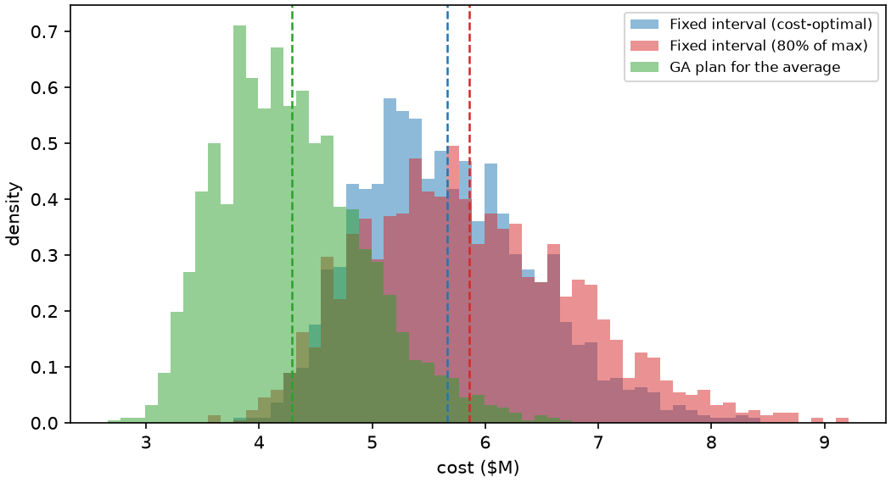

# Lesson 2 · Planning for the average

> The obvious way to plan under uncertain flying is to replace it with its average and
> optimise as if the future were known. AVR-04 already does that optimisation very well: a
> genetic algorithm within about 2 % of a proven bound. This lesson moves AVR-04's problem
> onto a flight-hour clock, shows that at constant utilization nothing changes (to fifteen
> significant digits), and then runs AVR-04's best plan through 2000 futures it did not
> expect. It costs 20 % more than it promised. The lesson takes that 20 % apart.

**Code:** [`src/fracsched/problem.py`](../../src/fracsched/problem.py),
[`scenarios.py`](../../src/fracsched/scenarios.py),
[`deterministic_baseline/`](../../src/fracsched/deterministic_baseline/) ·
**Tests:** [`tests/test_scenarios.py`](../../tests/test_scenarios.py) ·
**Results:** [`validation/results/deterministic.md`](../../validation/results/deterministic.md) ·
**Previous:** [Lesson 1](01-flying-hours-you-cant-predict.md) ·
**Next:** [Lesson 3](03-planning-for-many-futures.md)

## Learning objectives

By the end of this lesson you should be able to:

1. State AVR-04's scheduling problem and why its cost is a sum of *segment* costs.
2. Move the problem from a calendar clock to a flight-hour clock, and prove the two coincide
   at constant utilization.
3. Model what happens when a plan meets a future it did not expect: forced tasks (recourse).
4. Use Jensen's inequality to explain why uncertainty raises expected failures, even with no
   forced tasks at all.
5. Read the cost of a plan as a distribution, not a number.

---

## 1. AVR-04 in one page

A fleet of 10 aircraft each carries four components (APU, landing gear, hydraulic pump,
brakes). A plan picks the weeks of every preventive task over a 52-week horizon.

* **Wear.** Each component wears out with a Weibull hazard, shape $\beta > 1$. A failure is
  repaired *minimally* (to its state just before failing), so failures form a
  non-homogeneous Poisson process. The expected number of failures while the component ages
  from $a$ to $b$ is $H(b) - H(a)$, with $H(x) = (x/\eta)^\beta$ (Barlow & Proschan, 1965).
  A preventive task renews it.
* **Costs.** A task costs its labour and parts. Grounding the aircraft for a visit costs
  \$20 000 a week, shared by every task done in that visit. A failure costs its repair plus
  its downtime.
* **Constraints.** Minimum and maximum intervals per component type; hangar bays, labour
  hours and spare parts per week.

The key structural fact: between two consecutive renewals at weeks $s$ and $e$, the expected
failures depend only on $s$ and $e$. So a component's plan is a path through a time-indexed
graph (a DAG), each arc carrying a fixed cost. AVR-04's exact model (CP-SAT) and its GA's
best-response move both use that graph. Lesson 4 will use it too.

## 2. From weeks to flight hours

AVR-04 counts age in weeks because its flying is known: at a fixed rate, a week is a fixed
number of hours. Here hours vary, so age is counted in FH. Each type gets an FH scale and an
FH limit. AVR-04's values are converted at the design utilization $\bar u = 800/52$ FH a week:

```math
\eta_{\text{FH}} = \bar u \, \eta_{\text{weeks}}, \qquad L = \bar u \, I_{\max}, \qquad h_0 = \bar u \, a_0 ,
```

where $I_{\max}$ is AVR-04's maximum interval and $a_0$ the initial age in weeks. Each task
also gets a **calendar limit** 50 % longer than $I_{\max}$, the "FH or months, whichever
first" form of real maintenance programmes. At mean use the FH limit binds first; for a quiet
aircraft, the calendar one does.

**The two clocks agree at constant use.** If an aircraft flies exactly $\bar u$ every week,
a segment of $g$ weeks ages a component by $\bar u g$ FH, and

```math
H_{\text{FH}}(\bar u g) = \left(\frac{\bar u g}{\bar u \, \eta_{\text{weeks}}}\right)^\beta = \left(\frac{g}{\eta_{\text{weeks}}}\right)^\beta = H_{\text{weeks}}(g) .
```

No forced task can occur either, because $\bar u g \le \bar u I_{\max} = L$. So
`FleetProblem.at_mean()` is AVR-04's instance, field for field, and the scenario evaluator on
a constant scenario is AVR-04's evaluator. The results confirm it:

| plan | AVR-04 published | this project at $\bar u$ | rel. diff |
|---|---:|---:|---:|
| Fixed interval (cost-optimal) | \$4 772 492.91 | \$4 772 492.91 | < 1e-12 |
| GA, seed 2 (100 × 500 generations) | \$3 581 598.26 | \$3 581 598.26 | < 1e-12 |

Every GA seed reproduces AVR-04's published result, because `average_plan` *is* AVR-04's GA,
imported from `pmo` v1.0.0, run on the same instance with the same seed. This is the PLAN's
consistency check. From here on, any difference from AVR-04 is caused by uncertainty, and by
nothing else.

## 3. When the future disagrees: recourse

A plan is fixed in weeks. In a future where an aircraft flies faster than $\bar u$, a
component can reach its FH limit before its planned week. It cannot fly past the limit, so
the task is **forced** in the week the limit would be passed:

```math
\text{forced in week } t \iff \text{age at the start of } t + u_t > L \text{ and no task is planned at } t .
```

A forced task renews the component, costs the task plus an unscheduled visit (\$50 000,
2.5 times a planned week, because the operator must cover owner flights with charter), and
the planned task still happens later. That is the *recourse* of a two-stage problem: the plan
is decided now, the hours are revealed, and the forced tasks are what the plan pays for being
wrong. Lesson 5 lets the planner revise the plan instead.

The recourse inside a segment depends only on its two end points and the scenario. So the
cost is still a sum of segment costs. `segment_tables` computes them for every component,
start, end and scenario at once, and the tests check every entry against a naive simulator
that steps each component week by week.

## 4. What the average plan costs in 2000 futures

The three plans built for the average, judged on 2000 held-out scenarios
([results](../../validation/results/deterministic.md)):

| plan | cost at $\bar u$ | expected cost | P10 | P90 | CVaR 90 % | expected vs promised |
|---|---:|---:|---:|---:|---:|---:|
| Fixed interval (cost-optimal) | 4.772 | 5.662 ± 0.017 | 4.725 | 6.670 | 7.139 | +18.6 % |
| Fixed interval (80 % of max) | 4.838 | 5.856 ± 0.021 | 4.688 | 7.098 | 7.643 | +21.0 % |
| GA plan for the average | 3.582 | 4.291 ± 0.014 | 3.517 | 5.137 | 5.546 | +19.8 % |

(\$M over 52 weeks; ± is one Monte Carlo standard error.)



* **Every plan breaks its promise, by about a fifth.** The cost at $\bar u$ is not even the
  middle of the distribution: it sits near P10. Nine futures in ten cost more than planned.
* **The GA plan is still the best of the three.** Grouping tasks into shared hangar visits
  (31 visits instead of 81) is worth about \$1.4M in every future. Uncertainty does not undo
  AVR-04's result; it adds a cost on top that no plan built for one future can see.
* **The tail is wide.** One year in ten costs 5.1 \$M or more for the GA plan, and the worst
  10 % average 5.5 \$M, 55 % above the promise.

### Where the extra \$0.71M comes from

| GA plan for the average | at $\bar u$ | expected |
|---|---:|---:|
| expected failures | 22.86 | 25.00 |
| forced tasks | 0 | 8.84 |
| extra failure cost | | +0.195 \$M |
| forced-task cost | | 0.514 \$M |

Two different mechanisms.

**Forced tasks (0.51 \$M).** In fast futures components reach their limits before their
planned weeks. At $\bar u$ a task can sit anywhere inside its window at no risk, so the plan
has no reason to keep slack. Splitting its 142 segments by the share of the FH limit they fly
in an average future:

| share of the limit used at $\bar u$ | segments | forced tasks a year |
|---|---:|---:|
| under 50 % | 42 | 0.05 |
| 50 to 75 % | 75 | 3.02 |
| 75 to 90 % | 19 | 3.17 |
| 90 to 100 % | 6 | 2.61 |

The 25 segments that use 75 % or more of their limit cause 5.8 of the 8.8 forced tasks, and
a segment at 90 % or more is forced in 43 % of futures. Even the 50 to 75 % band is
forced 4 % of the time, because short intervals vary most (Lesson 1). In 99.3 % of futures at
least one task is forced.

**More failures (0.20 \$M), by Jensen's inequality.** Even without forced tasks, the expected
failures in a segment rise. The age at the end of a segment is a random variable $A$ with
mean $\bar u g$, and $H$ is convex for $\beta > 1$, so

```math
E[H(A)] \ge H(E[A]) = H(\bar u g) .
```

Spreading the hours symmetrically around their mean adds more failures in fast futures than
it removes in slow ones. The steeper the wear-out (the larger $\beta$), the bigger the gap.

## 5. Worked example

*One brake segment of 20 weeks* ($\beta = 3.5$, $L = 20\bar u = 307.7$ FH). Suppose half the
futures fly $0.8\bar u$ and half $1.2\bar u$.

1. **Failures.** $E[H(A)] = \tfrac12\left(0.8^{3.5} + 1.2^{3.5}\right) H(20\bar u) = \tfrac12(0.458 + 1.893) H(20\bar u) = 1.175 H(20\bar u)$.
   That is 17.5 % more expected failures than the plan assumes, from a symmetric ±20 % spread.
2. **Forced task.** In the fast future the limit is reached after $20/1.2 = 16.7$ weeks, so
   the task is forced in week 16: \$58 000 (task plus unscheduled visit), against \$8 000 for
   the planned task, which still happens in week 20.
3. **The slow future** wastes nothing extra here: the planned task in week 20 comes at
   246 FH, 80 % of the limit. That is life thrown away, but no cost the plan sees.

The asymmetry is the whole story: being late is expensive and being early is cheap. A plan
built for the average ignores that asymmetry. Lesson 3's plans are built to see it.

## 6. Code walkthrough

```python
from fracsched.deterministic_baseline import average_plan, constant_scenario
from fracsched.problem import main_problem
from fracsched.scenarios import evaluate, evaluate_in_chunks, segment_tables

problem = main_problem()  # AVR-04's main instance on the FH clock
plan = average_plan(problem).schedule  # pmo.ga.run_ga on problem.at_mean()

at_mean = evaluate(problem, segment_tables(problem, constant_scenario(problem)), plan)
print(at_mean.total[0])  # AVR-04's number

u = ...  # (S, 10, 52) scenarios from the Lesson 1 model
(ev,) = evaluate_in_chunks(problem, u, [plan])
print(ev.total.mean(), ev.forced_tasks.mean(), ev.expected_failures.mean())
```

* `FleetProblem` keeps AVR-04's `pmo.Instance` (capacities, costs, calendar limits) as
  `base`, and adds the FH side. The planned part of every cost (tasks, visits, constraint
  violations) is still computed by `pmo.evaluate`.
* `segment_tables` returns arrays of shape `(component, start, end, scenario)`. Scoring a
  plan is then a single gather over its segments, about 70 µs for 200 scenarios. That speed
  is what makes a GA over scenarios affordable in Lesson 3.

## Exercises

1. Show that a plan's expected cost over scenarios is a sum of expected segment costs, so the
   scenario-averaged table is enough for the mean, but not for CVaR.
2. For $\beta = 1$ (no wear-out), what does Jensen's inequality say about expected failures?
   Would the average plan still cost more than promised?
3. In the worked example, at what spread $\pm d$ does the failure term grow by 50 %?
4. The GA plan has fewer forced tasks than the fixed-interval plans (8.84 against 12.66),
   even though it was not built to avoid them. Suggest why.
5. A colleague proposes to fix the problem by planning at the P90 utilization instead of the
   mean. What would it fix, and what would it break?

### Solutions

1. The total is $\sum_{\text{segments}} c_{\text{seg}}(\omega)$. Expectation is linear, so
   $E[\sum c] = \sum E[c]$, which uses only the mean table. CVaR is not linear: the worst
   10 % of totals are not the sum of the worst 10 % of each segment. It needs the
   per-scenario table, which is why `segment_tables` keeps the scenario axis.
2. $H$ is linear, so $E[H(A)] = H(E[A])$ and the failure term is unbiased. Forced tasks would
   still occur in fast futures, so the plan would still cost more than promised, but only
   through recourse.
3. $\tfrac12((1-d)^{3.5} + (1+d)^{3.5}) = 1.5$. Expanding, $1 + \binom{3.5}{2}d^2 + \dots$, with
   $\binom{3.5}{2} = 4.375$. Solving numerically gives $d \approx 0.32$.
4. To share hangar visits it moves many tasks *earlier*, next to a visit the aircraft makes
   anyway: 42 of its 142 segments use under half of their FH limit at $\bar u$, and those are
   almost never forced. A fixed-interval rule places every task at the same high share of its
   interval. Consolidation buys some robustness by accident.
5. It would cut forced tasks, because intervals would be planned shorter. But every slow and
   average future would pay for tasks done too early, and nothing would weigh the two
   errors against each other. Lesson 3 does that weighing explicitly, across all futures.

## References

* GMCavalheri, *Preventive Maintenance Optimization with Genetic Algorithms* (AVR-04),
  v1.0.0,
  [github.com/GMCavalheri/Preventive-Maintenance-Optimization-with-Genetic-Algorithms](https://github.com/GMCavalheri/Preventive-Maintenance-Optimization-with-Genetic-Algorithms).
* R. E. Barlow and F. Proschan, *Mathematical Theory of Reliability*, Wiley, 1965 (minimal
  repair and the non-homogeneous Poisson process).
* T. Nakagawa, *Maintenance Theory of Reliability*, Springer, 2005, ch. 3–4 (periodic
  replacement with minimal repair).
* J. R. Birge and F. Louveaux, *Introduction to Stochastic Programming*, 2nd ed., Springer,
  2011, ch. 1–2 (two-stage problems, recourse, and the expected value of the
  expected-value solution, used in Lesson 8).
* J. L. W. V. Jensen, "Sur les fonctions convexes et les inégalités entre les valeurs
  moyennes", *Acta Mathematica* 30, 1906, pp. 175–193.
