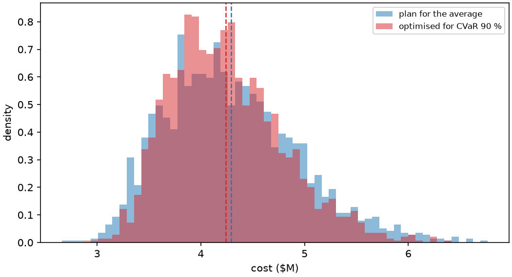

# Lesson 3 · Planning for many futures

> Lesson 2 judged plans on 2000 futures after the fact. The natural next step is to let the
> optimiser see futures *while* it searches: score each candidate plan on a sample of
> utilization scenarios and keep the one that does best across them. That is the
> sample-average approximation (SAA), the workhorse of stochastic programming. This lesson
> builds it on AVR-04's GA, asks three different questions of the sample (the average, the
> bad tail, the worst case), and checks every answer on futures the optimiser never saw.

**Code:** [`src/fracsched/robust_scenario_scheduling/`](../../src/fracsched/robust_scenario_scheduling/),
[`risk_measures.py`](../../src/fracsched/risk_measures.py) ·
**Tests:** [`tests/test_robust.py`](../../tests/test_robust.py),
[`tests/test_risk_measures.py`](../../tests/test_risk_measures.py) ·
**Results:** [`validation/results/robust.md`](../../validation/results/robust.md) ·
**Previous:** [Lesson 2](02-planning-for-the-average.md)

## Learning objectives

By the end of this lesson you should be able to:

1. Write the maintenance plan as a two-stage stochastic program and its sample-average
   approximation.
2. Define expected cost, CVaR and worst case as objectives, and compute CVaR two ways.
3. Explain how AVR-04's GA becomes a scenario GA by changing only its fitness and adding one
   move.
4. Measure a plan honestly: paired differences on held-out scenarios, with standard errors.
5. Explain in-sample optimism, and why it is worst for the worst case.

---

## 1. The problem, stated properly

Let $x$ be a plan (the weeks of every preventive task), $\omega$ a utilization future, and
$c(x, \omega)$ the plan's cost in that future: planned tasks and visits, failures, and forced
tasks (Lesson 2). The plan is chosen before $\omega$ is known. The **stochastic program** is

```math
\min_{x \in X} \; \rho\big(c(x, \omega)\big),
```

where $X$ holds the calendar- and capacity-feasible plans and $\rho$ is a way of summarising
a random cost. Lesson 2's plan solved a different problem, $\min_x c(x, \bar\omega)$, with
the single future $\bar\omega$ in which every aircraft flies $\bar u$.

We cannot compute $E[c(x,\omega)]$ exactly; the futures form a continuum. The **sample-average
approximation** replaces the distribution by $S$ sampled futures $\omega_1, \dots, \omega_S$,
each with weight $1/S$ (Kleywegt, Shapiro & Homem-de-Mello, 2002):

```math
\min_{x \in X} \; \rho_S\big(c(x, \omega_1), \dots, c(x, \omega_S)\big) .
```

As $S$ grows, its optimal value and solutions converge to the true problem's. For finite $S$
it is a deterministic problem, and AVR-04's machinery can solve it. Here $S = 100$.

## 2. Three ways to summarise a cost distribution

* **Expected cost**, $\rho = E$: the right objective for an operator who maintains a large
  fleet over many years and cares about the long-run average.
* **CVaR at level $\alpha$**: the mean of the worst $1-\alpha$ share of outcomes. For
  $\alpha = 0.9$, "how bad is a bad year, on average". It is a coherent risk measure (Artzner
  et al., 1999), and Rockafellar & Uryasev (2000) showed it is a minimum:

```math
\text{CVaR}_\alpha(c) = \min_{\eta} \left\{ \eta + \frac{1}{1-\alpha} E\big[(c - \eta)^+\big] \right\},
```

  with the minimum at $\eta$ equal to the $\alpha$ quantile (the value at risk, VaR). On $S$ equally
  likely scenarios this is the mean of the top $(1-\alpha)S$ costs, the boundary one counted
  fractionally. The tests compute it both ways, by sorting and by minimising over $\eta$.
* **Worst case**, $\rho = \max$: classical robust optimisation over the sampled futures. It
  protects against the single worst future in the sample, whatever its probability.

Expected cost and CVaR are linear in the scenario costs once $\eta$ is fixed. That matters in
Lesson 4: both can be solved exactly with a linear objective.

## 3. AVR-04's GA, judged on 100 futures

The GA is AVR-04's, imported from `pmo` and reused unchanged:

* **encoding**: the desired weeks of each component's tasks;
* **decoder**: repairs a genotype into a feasible plan and writes it back (Lamarckian);
* **crossover**: swaps whole component or aircraft blocks;
* **mutations**: shift, add, remove, align and merge visits, re-plan a component;
* **seeding**: fixed-interval plans.

Three things are new:

1. **Fitness.** Decode, compute the planned part with `pmo.evaluate` (tasks, visits,
   violations), gather the plan's segment costs from the in-sample table (one array lookup,
   Lesson 2), and reduce the $S$ totals with $\rho$. Add AVR-04's penalty per unit of
   violation. Round to cents: a tournament then cannot be decided by a last-bit difference
   between two CPUs, and every result reproduces exactly.
2. **Scenario best response.** Half of all mutations re-plan one component, all others
   fixed, as the shortest path through the DAG of Lesson 2 with the *scenario-averaged*
   segment costs. A task costs less in a week the aircraft is already in the hangar, which
   keeps the consolidation AVR-04 found valuable. A test checks it against enumeration of
   every feasible plan of a component.
3. **Warm start.** The plan for the average joins the initial population. With elitism the
   GA can then only improve on it in sample, so every difference measured below is a gain
   found by looking at the futures.

One run (100 individuals × 400 generations) takes about 40 s on one core. Three seeds per
objective run in parallel, and the planner keeps the run with the best in-sample value.

## 4. Results on futures the optimiser never saw

The plans are judged on the same 2000 held-out futures as in Lesson 2
([results](../../validation/results/robust.md)), in \$M over 52 weeks:

| plan | mean ± se | P90 | CVaR 90 % | worst |
|---|---:|---:|---:|---:|
| plan for the average | 4.291 ± 0.014 | 5.137 | 5.546 | 6.765 |
| optimised for expected cost | 4.201 ± 0.013 | 4.975 | 5.333 | 6.461 |
| optimised for CVaR 90 % | 4.242 ± 0.012 | 4.957 | 5.310 | 6.375 |
| optimised for worst case | 4.353 ± 0.012 | 5.056 | 5.395 | 6.525 |

The standard errors of the means overlap less than they seem to, because every plan faces
*the same* futures. The right comparison is **paired**: the difference in each future, then
its mean and standard error.

| against the plan for the average | mean change ± se | CVaR 90 % change | futures cheaper |
|---|---:|---:|---:|
| optimised for expected cost | −0.089 ± 0.003 (−2.08 %) | −0.213 | 74 % |
| optimised for CVaR 90 % | −0.049 ± 0.003 (−1.14 %) | −0.237 | 59 % |
| optimised for worst case | +0.063 ± 0.004 (+1.46 %) | −0.151 | 31 % |



* **Looking at the futures pays, but modestly.** The expected-cost plan saves 2.1 % on
  average, about \$89 000 a year on this fleet, with a standard error 30 times smaller than
  the saving. It is cheaper in three futures out of four.
* **The CVaR plan trades a little average for a better tail.** It gives up about one point of the
  mean saving (1.14 % instead of 2.08 %) and cuts the mean of the worst decile by \$237 000 (4.3 %).
* **The worst-case plan is worse on average and not even best in the tail.** It is more
  expensive on average than the plan for the average, and its held-out worst case is higher
  than the CVaR plan's.

### What the robust plans do differently

| plan | tasks | visits | planned cost | expected failures | forced tasks |
|---|---:|---:|---:|---:|---:|
| plan for the average | 102 | 31 | 1.820 | 25.00 | 8.84 |
| optimised for expected cost | 112 | 36 | 2.005 | 23.38 | 6.00 |
| optimised for CVaR 90 % | 117 | 38 | 2.096 | 22.82 | 5.64 |

They **buy slack**. Ten to fifteen more tasks and a few more visits cost \$0.19 to \$0.28M of
planned money. In return, forced tasks fall by a third and failures by 6 to 9 %. The planned
cost is certain and the savings are uncertain, so the expected-cost plan buys only as much
slack as pays on average. The CVaR plan buys more, because the futures it cares about most
are the fast ones, where slack pays most.

## 5. In-sample optimism

An optimiser that sees 100 futures will exploit their particular features. Its in-sample
value is therefore optimistic: in expectation the SAA optimum is below the true optimum
(Mak, Morton & Wood, 1999). Here the in-sample set also happens to be about 2.5 % more
expensive than the population, so the fair comparison is the *improvement* over the plan for
the average, measured on each side:

| objective | improvement in sample | improvement held out |
|---|---:|---:|
| expected cost | −2.77 % | −2.08 % |
| CVaR 90 % | −5.59 % | −4.27 % |
| worst case | −11.99 % | −3.55 % |

The pattern is the point. The mean of 100 numbers is a stable statistic, and three quarters of
the in-sample gain survives. CVaR averages the worst 10, and about three quarters survives
again. The maximum of 100 numbers is decided by *one* future: the GA learns to protect against
that particular future, and less than a third of the gain carries over to new ones. A
worst-case objective needs far more scenarios, or a model of the uncertainty set, to mean
anything. Its noisy objective also explains why it ends up more expensive on average.

## 6. Worked example

*CVaR of ten futures.* Costs (\$M): 4.1, 4.3, 3.9, 5.6, 4.0, 4.4, 6.2, 4.2, 4.8, 4.5.

1. Sorted, highest first: 6.2, 5.6, 4.8, 4.5, …
2. CVaR at $\alpha = 0.9$ averages the worst $(1 - 0.9) \cdot 10 = 1$ future: 6.2.
3. CVaR at $\alpha = 0.75$ averages the worst 2.5: $(6.2 + 5.6 + 0.5 \cdot 4.8)/2.5 = 5.68$.
4. Check with Rockafellar-Uryasev at $\eta = 4.8$:
   $4.8 + \frac{(6.2 - 4.8) + (5.6 - 4.8)}{0.25 \cdot 10} = 4.8 + 0.88 = 5.68$.

## 7. Code walkthrough

```python
from fracsched.problem import main_problem
from fracsched.robust_scenario_scheduling import RobustConfig, run_robust_ga
from fracsched.scenarios import cost_table, evaluate_in_chunks

problem = main_problem()
u_in = ...  # (100, 10, 52) in-sample futures
table = cost_table(problem, u_in)  # (component, start, end, scenario) costs
result = run_robust_ga(problem, table, RobustConfig(objective="cvar", alpha=0.9), seeds=[average])
(ev,) = evaluate_in_chunks(problem, u_out, [result.schedule])  # judge on held-out futures
```

`run_many` runs several seeds or objectives in parallel processes; each process builds its
own table from the scenarios, so nothing large is copied between processes.

## Exercises

1. Show that for the expected-cost objective the scenario best response is exact: no plan of
   that component, with the others fixed, has a lower sample-average cost, capacity aside.
2. Why is the best response only a heuristic for CVaR? What would an exact one need?
3. The paired standard error of the expected-cost saving is 0.003 \$M, while each plan's own
   standard error is about 0.013. Explain the difference with a formula.
4. Suppose the in-sample set had 1000 scenarios. Which row of the optimism table would
   change most, and in which direction?
5. An operator says: "I only care about the worst year, so optimise the worst case." Using
   the results, argue for CVaR instead.

### Solutions

1. The sample-average cost of the whole plan is a sum over components of that component's
   segment costs plus its task costs, and the task costs depend on the others only through
   which weeks the aircraft is already in. With the others fixed, that is exactly the arc
   costs of the shortest-path problem, so the shortest path is optimal. Capacity is left to
   the decoder, which can move a task if a week is full.
2. CVaR is not a sum of per-component terms: which scenarios form the worst decile depends on
   every component together. An exact move would have to include the other components'
   per-scenario costs as a constant vector and optimise the CVaR of the sum, which needs the
   Rockafellar-Uryasev variable $\eta$ and one auxiliary variable per scenario, as in Lesson 4.
3. $\text{Var}(A - B) = \text{Var}(A) + \text{Var}(B) - 2 \text{Cov}(A, B)$. Two plans facing the
   same future have highly correlated costs (a fast year is expensive for both), so the
   covariance cancels most of the variance. With correlation $r$ and equal variances the
   paired se is $\sqrt{2(1-r)}$ times one plan's; 0.003/0.013 means $r \approx 0.97$.
4. The worst case. The maximum of 1000 futures is more extreme and still decided by a handful
   of them, so the in-sample improvement would stay optimistic. But the plan would protect
   against a broader set of bad futures, so the held-out improvement would rise. Expected
   cost would change least.
5. The worst-case plan's held-out worst case (6.525) is higher than the CVaR plan's (6.375),
   and it costs 2.6 % more on average than the CVaR plan. Optimising the single worst sampled
   year chases noise; CVaR averages enough bad years to learn something that generalises.

## References

* A. J. Kleywegt, A. Shapiro and T. Homem-de-Mello, "The sample average approximation method
  for stochastic discrete optimization", *SIAM Journal on Optimization* 12(2), 2002,
  pp. 479–502.
* R. T. Rockafellar and S. Uryasev, "Optimization of conditional value-at-risk", *Journal of
  Risk* 2(3), 2000, pp. 21–41.
* P. Artzner, F. Delbaen, J.-M. Eber and D. Heath, "Coherent measures of risk", *Mathematical
  Finance* 9(3), 1999, pp. 203–228.
* W. K. Mak, D. P. Morton and R. K. Wood, "Monte Carlo bounding techniques for determining
  solution quality in stochastic programs", *Operations Research Letters* 24(1–2), 1999,
  pp. 47–56.
* A. Shapiro, D. Dentcheva and A. Ruszczyński, *Lectures on Stochastic Programming: Modeling
  and Theory*, 2nd ed., SIAM, 2014, ch. 5 (statistical inference for SAA).
* A. Ben-Tal, L. El Ghaoui and A. Nemirovski, *Robust Optimization*, Princeton University
  Press, 2009.
* F.-A. Fortin et al., "DEAP: Evolutionary algorithms made easy", *Journal of Machine
  Learning Research* 13, 2012, pp. 2171–2175.
