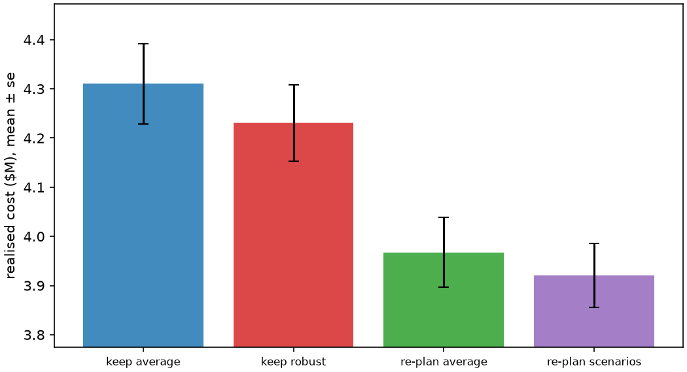
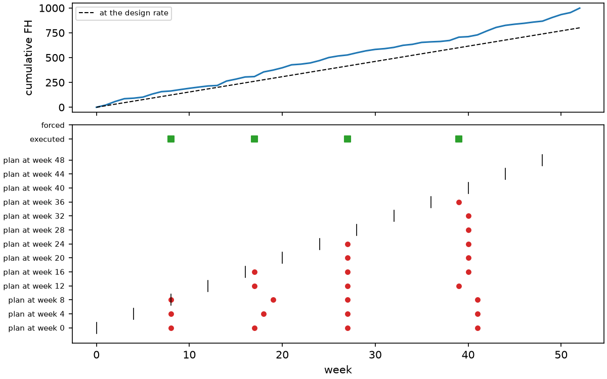

# Lesson 5 · Re-planning as the hours come in

> Lessons 2 to 4 treated the plan as a promise made once, at week 0, for the whole year. No
> operator works that way. Every few weeks the planners see which aircraft flew more than
> expected and which sat idle, and they move tasks. This lesson simulates that loop: re-plan
> every four weeks from the observed state, commit the next four weeks, repeat. The result
> reorders everything learned so far. Looking at the futures when the plan is made saves
> 2 %. Looking at the present every four weeks saves 8 to 9 %.

**Code:** [`src/fracsched/dynamic_rescheduling/`](../../src/fracsched/dynamic_rescheduling/) ·
**Tests:** [`tests/test_rolling.py`](../../tests/test_rolling.py) ·
**Results:** [`validation/results/rolling.md`](../../validation/results/rolling.md) ·
**Previous:** [Lesson 4](04-the-exact-answer-for-a-sampled-future.md)

## Learning objectives

By the end of this lesson you should be able to:

1. Describe a rolling-horizon policy: state, decision epochs, commitment (freeze) and
   look-ahead.
2. Rebuild the state of a maintenance system from what was observed, including forced tasks.
3. Distinguish a deterministic look-ahead from a stochastic look-ahead, and sample futures
   conditionally on the present.
4. Evaluate policies fairly: the same actual futures, paired differences, realised cost.
5. Explain why re-planning is worth more than planning for uncertainty once.

---

## 1. From a plan to a policy

A **plan** is a list of task weeks. A **policy** is a rule that maps what you know now to what
you do next. In a rolling-horizon policy (Sethi & Sorger, 1991; Chand, Hsu & Sethi, 2002):

1. at epoch $k$ (here every $P = 4$ weeks) observe the **state**;
2. solve a planning problem for the rest of the horizon, weeks $k, \dots, T-1$ (the
   **look-ahead**);
3. **commit** the tasks of weeks $k, \dots, k + P - 1$ and execute them;
4. move to $k + P$ and repeat.

Powell (2022) calls this a *direct look-ahead* policy, and separates two kinds by what the
look-ahead assumes about the future:

* **deterministic look-ahead**: plan the rest of the year as if every aircraft flew $\bar u$
  ("re-plan for the average");
* **stochastic look-ahead**: plan it against sampled futures, Lesson 3's SAA, with the futures
  sampled *given the present* ("re-plan on conditional scenarios").

The commitment window is the planning freeze. The PLAN suggested a two-week freeze inside a
monthly cycle; here the freeze is the whole four weeks between re-plans, which keeps AVR-04's
decoder unchanged (it has no notion of a fixed task) and errs on the conservative side.

## 2. The state

What does the operator know at the start of week $k$?

* **Each component's age**: weeks since its last renewal (for the calendar limit) and FH since
  it (for wear and the FH limit). Renewals include *forced* tasks. `component_state` replays
  the actual hours week by week with the evaluator's rule and returns both ages and the forced
  weeks; a test checks that it finds exactly the evaluator's forced tasks.
* **Remaining capacity**: the hangar bays and labour of the remaining weeks, and the spare
  parts on hand: the initial stock plus deliveries so far minus parts used by executed tasks.
  `FleetProblem.subproblem` builds the remaining problem from these.
* **The demand state**: each aircraft's regime (idle, normal, spike) and the fleet demand
  factor. In practice this is the booking situation: which owners are travelling, which
  aircraft is positioned far away. The model assumes the operator observes it.

The last item matters for the stochastic look-ahead. Lesson 1's model can sample futures
*conditionally*: start the Markov chains from the observed regimes and the AR(1) from the
observed demand factor. An aircraft observed in a spike will probably keep flying hard for
a few weeks; one observed idle will probably stay quiet. Unconditional scenarios would forget
both.

A useful check that the bookkeeping is right: expected failures split additively at a
re-plan. The failures of the whole year equal those before week $k$ plus those of the
sub-problem started from the observed state, because $H(a + b) - H(0) = [H(a) - H(0)] + [H(a + b) - H(a)]$.
A test confirms it to $10^{-10}$.

## 3. The experiment

48 actual years, each drawn week by week from the utilization model. Four policies run on
each year, so every comparison is paired:

| policy | start | every 4 weeks |
|---|---|---|
| keep the plan for the average | Lesson 2's plan | nothing |
| keep the robust plan | Lesson 3's expected-cost plan | nothing |
| re-plan for the average | Lesson 2's plan | GA on one scenario at $\bar u$, from the observed state |
| re-plan on conditional scenarios | Lesson 3's plan | GA on 30 futures sampled given the observed state |

Both re-planning policies run Lesson 3's GA with a small budget (40 × 50) and warm-start it
with the rest of the current plan, so a re-plan can only improve on "keep" in its own
look-ahead. The realised cost of a year is the cost of the tasks actually executed, evaluated
on the actual hours: tasks and visits, forced tasks, and expected failures given the realised
ages.

## 4. Results

From [`validation/results/rolling.md`](../../validation/results/rolling.md):

| policy | realised cost (\$M) | tasks | visits | forced tasks | expected failures |
|---|---:|---:|---:|---:|---:|
| keep the plan for the average | 4.310 ± 0.082 | 102.0 | 31.0 | 8.98 | 25.13 |
| keep the robust plan | 4.231 ± 0.077 | 112.0 | 36.0 | 6.21 | 23.59 |
| re-plan for the average | 3.967 ± 0.071 | 104.2 | 35.2 | 3.08 | 23.90 |
| re-plan on conditional scenarios | 3.920 ± 0.065 | 110.3 | 38.1 | 1.92 | 22.56 |

Paired against keeping the plan for the average:

| policy | change (\$M) ± se | change | years cheaper |
|---|---:|---:|---:|
| keep the robust plan | −0.079 ± 0.017 | −1.84 % | 73 % |
| re-plan for the average | −0.343 ± 0.021 | −7.95 % | 100 % |
| re-plan on conditional scenarios | −0.390 ± 0.026 | −9.05 % | 100 % |



* **Re-planning is the big lever.** Re-planning for the average is cheaper than keeping the
  average plan in *every one* of 48 years, by 8 % on average. The static robust plan of
  Lesson 3 saves less than a quarter of that.
* **The gain is forced tasks avoided.** They fall from 9.0 a year to 3.1 when re-planning, and
  to 1.9 when re-planning on conditional scenarios. A component that is wearing faster than
  planned is seen at the next epoch, and its task is brought forward into a planned visit,
  usually one the aircraft makes anyway.
* **Uncertainty-aware re-planning still adds.** Re-planning on conditional scenarios instead of
  for the average saves a further 0.047 ± 0.014 \$M (1.1 %). It buys a little more slack
  (110 tasks against 104), and the conditional futures tell it which aircraft are likely
  to keep flying hard.



The figure follows one component through one simulated year. Its aircraft flies above the
design rate from the first weeks (top). At week 0 its last task of the year is planned for
week 41. As the extra hours accumulate, the re-plans pull that task earlier, to week 39 or 40,
and it is executed in week 39 as a planned task. None of its tasks is forced.

## 5. Why re-planning beats planning for uncertainty once

A plan made at week 0 must hedge against the whole year's uncertainty with one decision. By
Lesson 1, the uncertainty in when a component reaches its limit grows with the time to the
limit: the P10 to P90 range of a 600 FH interval is 28 weeks. A re-plan at week $k$ only needs
to hedge the uncertainty of the *next* few weeks before the following re-plan, plus the
remainder, which is itself re-planned later. So the information gained by waiting is worth
much more than any hedge chosen in advance. In the language of stochastic programming, the
real problem is *multi-stage*. A two-stage model (plan now, absorb the rest as recourse) is a
pessimistic approximation of it. Lesson 8 measures that gap for the static plans.

The flip side is a cost: re-planning moves tasks, and each move has operational costs this
model does not price (parts re-ordered, slots re-booked, crews re-assigned). The four-week
commitment caps the churn. A real operator would add a penalty per moved task, a natural
extension.

## 6. Worked example

*One brake (FH limit 307.7 FH, last task at week 0) on an aircraft flying 22 FH a week, 43 %
above $\bar u$.*

1. **Plan at week 0, for the average:** the limit is reached at
   $307.7 / 15.38 = 20$ weeks, so the task is planned in week 20.
2. **What actually happens:** at 22 FH a week the limit is passed during week 13
   ($14 \times 22 = 308 > 307.7$). Without re-planning the task is forced in week 13, at
   \$58 000 instead of \$8 000. The planned task in week 20 still happens.
3. **With re-planning at week 4:** the operator sees $4 \times 22 = 88$ FH flown and an aircraft
   in a spike regime. At the design rate the remaining 219.7 FH would last until week 18; at
   the observed rate the limit is passed in week 13. The conditional look-ahead plans the
   brake no later than week 13, next to any visit that aircraft already has, and the week-8
   re-plan can still adjust it.
4. **Saving:** at least the \$50 000 unscheduled premium, plus a planned task that would have
   been done a week after its forced replacement.

## 7. Code walkthrough

```python
import numpy as np

from fracsched.dynamic_rescheduling import (
    RollingConfig,
    deterministic_policy,
    robust_policy,
    sample_actual,
    simulate,
)
from fracsched.utilization_model import default_model

model, cfg = default_model(), RollingConfig(period=4, n_scenarios=30)
actual = sample_actual(model, np.random.default_rng(7), 10, 52)  # hours and observed states
out = simulate(
    problem, robust_plan, actual, robust_policy(model, cfg), cfg, np.random.default_rng(0)
)
print(out.evaluation.total[0], out.evaluation.forced_tasks[0], len(out.plans))
```

`simulate` keeps two lists: the plan in force, rewritten at each epoch from week $k$ on, and
the executed tasks, appended four weeks at a time and never rewritten. A test checks that the
weeks before the first re-plan are executed exactly as first planned.

## Exercises

1. Is re-planning for the average guaranteed to be cheaper than keeping the plan, in every
   year? Why was it in all 48 here?
2. What would you expect from re-planning every week ($P = 1$)? What would it cost in
   practice?
3. The stochastic look-ahead assumes the operator observes each aircraft's regime. If it
   only observed the hours, how could it estimate the regime?
4. The static robust plan saves 1.8 % and re-planning on conditional scenarios saves 9.1 %.
   Does that make Lesson 3 pointless?
5. Suggest a way to price plan churn, and how it would change the GA's fitness.

### Solutions

1. No. Each re-plan improves the *look-ahead* problem, not the realised cost: a re-plan for
   the average can move a task later, and then the actual hours can force it anyway. Here the
   warm start and the frequent epochs make that rare. Every year had several components
   heading for a forced task that the re-plans caught, so the net effect was always a saving.
2. More information, fewer forced tasks, but diminishing returns: with $P = 4$ the forced
   tasks are already down to 1.9 a year. In practice a weekly re-plan of the whole fleet
   would churn slots, parts and crews; the commitment window exists to limit that.
3. Filter it. The regime is a hidden Markov chain and the hours are its emissions (Gamma given
   the regime), so the forward algorithm gives the probability of each regime given the hours
   so far. The conditional sampler would then start each chain from that distribution instead
   of a known state.
4. No, for two reasons. The re-planning policy *starts* from Lesson 3's plan and uses Lesson 3's
   GA on conditional scenarios. And where re-planning is not possible (parts with long lead
   times, hangar slots booked a year ahead), the first plan is the only plan.
5. Add a cost per task that differs from the plan in force: for example \$1000 per task moved
   more than one week. In the GA's fitness this is a deterministic term computed from the
   candidate and the current plan, like the planned cost, so nothing else changes.

## References

* S. Sethi and G. Sorger, "A theory of rolling horizon decision making", *Annals of Operations
  Research* 29, 1991, pp. 387–415.
* S. Chand, V. N. Hsu and S. Sethi, "Forecast, solution, and rolling horizons in operations
  management problems: a classified bibliography", *Manufacturing & Service Operations
  Management* 4(1), 2002, pp. 25–43.
* W. B. Powell, *Reinforcement Learning and Stochastic Optimization: A Unified Framework for
  Sequential Decisions*, Wiley, 2022, ch. 19 (direct look-ahead policies).
* J. R. Birge and F. Louveaux, *Introduction to Stochastic Programming*, 2nd ed., Springer,
  2011, ch. 7 (multistage problems).
* L. R. Rabiner, "A tutorial on hidden Markov models and selected applications in speech
  recognition", *Proceedings of the IEEE* 77(2), 1989, pp. 257–286 (the forward algorithm).
