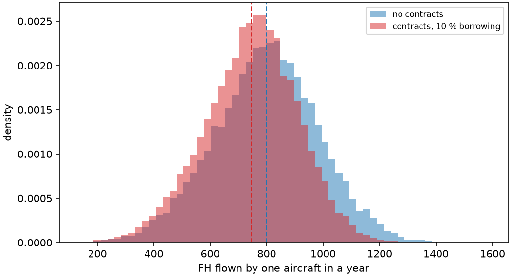

# Lesson 6 · Who owns the hours

> So far the hours came from a model of aircraft, as if each tail decided how much to fly.
> In a fractional programme, owners decide, under contracts: each owns a share of an aircraft
> and an annual allocation of hours, and can borrow only a little from next year. This lesson
> adds the contracts (PLAN extension 1) and asks a precise question: do the caps in those
> contracts make maintenance more predictable? They do for the fleet. They barely do for the
> aircraft, and the aircraft is where components fall due.

**Code:** [`src/fracsched/contracts/`](../../src/fracsched/contracts/) ·
**Tests:** [`tests/test_contracts.py`](../../tests/test_contracts.py) ·
**Results:** [`validation/results/contracts.md`](../../validation/results/contracts.md) ·
**Previous:** [Lesson 5](05-re-planning-as-the-hours-come-in.md)

## Learning objectives

By the end of this lesson you should be able to:

1. Describe how a fractional programme sells hours: shares, allocations, borrowing, pooled
   dispatch.
2. Model owner-level caps on a fleet's hours and keep the bookkeeping exact.
3. Explain why a cap on owners reduces the fleet's variability far more than an aircraft's.
4. Separate the two effects of a cap on a maintenance plan: a lower mean and a thinner tail.

---

## 1. How a programme sells hours

* **Shares.** An owner buys a fraction of a specific aircraft. US rules set the smallest
  fraction a programme may sell in a fixed-wing aircraft at 1/16 (14 CFR 91.1001(b)(10)), and
  the most common purchases are 1/8 to 1/4.
* **Allocations.** Each share comes with hours: a whole aircraft is sold as 800 hours a year,
  so 1/16 = 50 hours, 1/8 = 100, 1/4 = 200 (Flexjet's programme description).
* **Borrowing.** An owner who flies more than the allocation can usually borrow from next
  year, with limits that vary by programme (NBAA's fractional ownership FAQ). Beyond that,
  the owner is refused, or pays charter rates elsewhere.
* **Pooled dispatch.** Owners do not fly "their" tail. The operator sends whichever aircraft
  is best placed. So contracts act on the *fleet's* hours, not on any single aircraft's.

The model's programme: 76 owners holding 20 quarter, 24 eighth and 32 sixteenth shares, which
add up to the 10 aircraft. Every value except the 1/16 minimum and the 800 hours is an
illustrative assumption, labelled in
[`contract_parameters.csv`](../../src/fracsched/data/contract_parameters.csv).

## 2. The model

Each scenario-year, owner $i$ with share $s_i$ draws an intensity $w_i$ (Gamma, mean 1, CV
0.25): how much of the allocation that owner wants this year. Each week the fleet's requested
hours $Q_t = \sum_a u_{a,t}$ (Lesson 1's model) are split among owners in proportion to
$s_i w_i$. Owners are served week by week until their flown hours reach the cap:

```math
\text{served}_{i,t} = \min\left( q_{i,t}, \; \max\left(0, \; (1 + b)\,800\,s_i - \sum_{\tau < t} \text{served}_{i,\tau}\right) \right),
```

with borrowing allowance $b$. The aircraft then fly the hours that were served: every
aircraft's week shrinks by the same ratio $r_t$, the hours served to all owners that week
over $Q_t$. The tests
check the bookkeeping: hours flown by the aircraft equal hours served to the owners, no owner
passes the cap, and more borrowing never means fewer hours.

## 3. What the caps do to the hours

From the [results](../../validation/results/contracts.md), on 2000 held-out futures:

| borrowing | owner-years at the cap | hours refused | mean FH / aircraft-year | fleet CV | aircraft CV |
|---|---:|---:|---:|---:|---:|
| 0 % | 0.458 | 10.6 % | 714 | 0.053 | 0.220 |
| 10 % | 0.322 | 6.7 % | 745 | 0.066 | 0.221 |
| 25 % | 0.169 | 3.1 % | 774 | 0.082 | 0.224 |
| no cap | 0 | 0 | 799 | 0.103 | 0.232 |



**Caps calm the fleet, not the aircraft.** With 10 % borrowing the fleet's annual coefficient
of variation falls by a third (0.103 to 0.066), but a single aircraft's barely moves (0.232 to
0.221). The reason is Lesson 1's decomposition. The fleet total's variability comes mostly from
the shared demand factor, and the caps cut exactly that: busy years for everyone. An aircraft's
variability comes mostly from its own regimes (idle spells, spikes), which are about which
tail the operator dispatches, not about how much the owners fly. No owner contract touches
them.

**Caps lower the mean.** In this model owners want, on average, their full allocation. So
caps refuse hours in busy years without returning any in quiet ones, and the mean falls from
799 to 745 FH an aircraft-year with 10 % borrowing. (A programme whose owners use less than
their allocation on average would see a smaller drop.)

## 4. What the caps do to the maintenance plan

Under the default contracts (10 % borrowing), held out:

| plan | mean (\$M) ± se | CVaR 90 % | forced tasks | change vs average |
|---|---:|---:|---:|---:|
| plan for the average | 3.964 ± 0.009 | 4.749 | 6.84 | — |
| robust plan (no contracts) | 3.936 ± 0.009 | 4.688 | 4.82 | −0.028 ± 0.002 |
| robust plan (contract scenarios) | 3.913 ± 0.009 | 4.630 | 5.23 | −0.051 ± 0.002 |

And how the robust plan's edge moves with the cap:

| borrowing | plan for the average | robust plan | difference |
|---|---:|---:|---:|
| 0 % | 3.815 | 3.814 | −0.03 % |
| 10 % | 3.964 | 3.936 | −0.70 % |
| 25 % | 4.124 | 4.066 | −1.41 % |
| no cap | 4.291 | 4.201 | −2.08 % |

* **Every plan gets cheaper under caps**, because aircraft fly less: fewer hours, fewer
  failures, fewer forced tasks (8.8 a year without caps, 6.8 with 10 % borrowing).
* **The value of planning for uncertainty shrinks**, from 2.1 % to 0.7 %, and to nothing with no
  borrowing. Most of that is the lower mean, not the thinner tail. A plan built for 800 hours
  a year has slack when the fleet flies 745, the slack a robust plan would otherwise buy.
* **Planning on the right scenarios still pays.** Re-optimising on contract-capped scenarios
  saves 1.3 %, almost twice what the uncapped robust plan saves. Its forced tasks are slightly
  higher (5.23 against 4.82), and its expected cost lower. It buys exactly as much slack as the
  capped future needs, and no more.

The planning lesson: **know whose hours you are planning for.** A contract-blind plan is wrong
twice. It plans for the brochure's 800 hours when the owners' contracts will deliver fewer,
and it expects caps to tame the variability of each aircraft when they only tame the fleet's.

## 5. Worked example

*Two owners of half an aircraft each, an allocation of 0.5 × 40 = 20 hours, no borrowing, no
intensity spread, and an aircraft requested for 10 FH a week.*

1. Each owner requests 5 FH a week.
2. After 4 weeks each has flown 20 FH: both are at the cap.
3. From week 5 both are refused, so the served ratio is 0 and the aircraft flies nothing.
4. Flown: 10, 10, 10, 10, 0, 0. This is the test `test_capping_by_hand`.

Now give owner 1 an intensity of 1.5 and owner 2 one of 0.5: owner 1 requests 7.5 FH a week
and reaches the cap in week 3 (after $7.5 \times 3 = 22.5$, served 20), while owner 2 requests
2.5 a week and never reaches it in 6 weeks. The *same* fleet demand now loses fewer hours to
the caps, which is why the intensity spread matters for how often caps bind.

## 6. Code walkthrough

```python
import numpy as np

from fracsched.contracts import apply_contracts, default_programme

programme = default_programme(borrowing=0.1)  # 76 owners, 10 aircraft, 800 h each
capped = apply_contracts(u, programme, np.random.default_rng(6))
print(capped.capped.mean(), 1 - capped.u.sum() / u.sum())  # owner-years capped, hours refused
```

`apply_contracts` returns the hours each aircraft actually flies (`capped.u`), which go into
`cost_table` and the GA exactly like uncapped scenarios. Nothing else in the pipeline changes.
That is the advantage of a simulation-based evaluator: a new source of uncertainty or a new
constraint on the hours is a change to the scenarios, not to the optimiser.

## Exercises

1. Why does the model split *requested* hours among owners in proportion to $s_i w_i$, rather
   than give each aircraft its own owners?
2. With no borrowing, almost half of owner-years hit the cap. What would have to be true of
   real owners for that to be unrealistic, and how would you change the model?
3. Show that if every owner had the same intensity ($w_i = 1$), the caps would bind for all
   owners in exactly the same week. What does the intensity spread change?
4. The robust plan optimised on contract scenarios has *more* forced tasks than the uncapped
   robust plan, but a lower expected cost. How?
5. Suggest a contract term that *would* reduce an aircraft's own variability.

### Solutions

1. Dispatch is pooled: an owner flies whichever aircraft is available. Hours are owned at the
   programme level, so the cap acts on the fleet's hours, and the operator's dispatch decides
   which aircraft absorbs the cut. Spreading the cut in proportion to each aircraft's
   requested hours is the neutral assumption.
2. Real owners would have to use less than their allocation on average, typically with some
   unused hours rolled forward. Model it with an intensity mean below 1 (say 0.85) and a
   carry-forward balance from the previous year. The caps would then bind less often and lower
   the mean less.
3. With $w_i = 1$, owner $i$ requests $Q_t s_i / \sum s$ each week, a fixed fraction of the
   fleet total. Every owner's cumulative requests reach the same fraction of their allocation
   at the same time, so all caps bind together. The intensity spread staggers them: heavy
   owners are capped early while light ones keep flying. The fleet then loses hours more
   gradually and less in total.
4. It buys less slack than the uncapped robust plan, which was built for futures with more
   hours. It accepts a few more forced tasks and saves more than their cost in planned tasks
   and visits it does not need.
5. Anything that limits how unevenly *tails* are used, for example an operator rule to rotate
   aircraft so each flies within a band of the fleet average. That acts on the dispatch, the
   source of an aircraft's own regimes, and makes per-aircraft FH more predictable. Owner
   contracts cannot.

## References

* Title 14 CFR § 91.1001(b)(10), definition of a minimum fractional ownership interest
  (Part 91, Subpart K).
* FAA, Advisory Circular 91-84, *Fractional Ownership Programs*.
* NBAA, *Fractional Aircraft Ownership FAQ*,
  [nbaa.org](https://nbaa.org/flight-department-administration/aircraft-operating-ownership-options/fractional-ownership/fractional-aircraft-ownership-faq/),
  accessed 2026-11-19 (borrowing from next year's allocation).
* Flexjet, *Fractional ownership*, [flexjet.com/fractional-ownership](https://flexjet.com/fractional-ownership),
  accessed 2026-11-19 (shares and hours).
