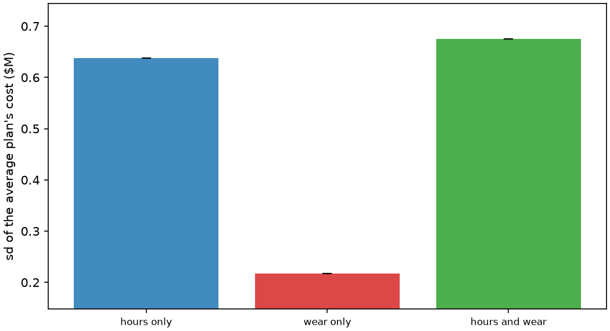

# Lesson 7 · Uncertain wear on top of uncertain hours

> Every plan so far knew exactly how fast each component wears: AVR-04's Weibull scale was
> taken as the truth. A small business-jet fleet does not know it. It has seen a handful of
> failures in a few years, and it borrows the rest of its belief from a bigger fleet that
> flies differently. That is the problem EJD-01 solved with Bayesian methods. This lesson
> plugs EJD-01's answer into the scheduler (PLAN extension 2) and asks which uncertainty
> matters more for maintenance planning: how much the aircraft will fly, or how fast its
> parts wear.

**Code:** [`src/fracsched/bayesian_risk/`](../../src/fracsched/bayesian_risk/) ·
**Tests:** [`tests/test_bayesian_risk.py`](../../tests/test_bayesian_risk.py) ·
**Results:** [`validation/results/bayesian.md`](../../validation/results/bayesian.md) ·
**Previous:** [Lesson 6](06-who-owns-the-hours.md) ·
**Next:** [Lesson 8](08-the-price-of-planning-for-the-average.md)

## Learning objectives

By the end of this lesson you should be able to:

1. Show that, for a known Weibull shape, the failures of a minimally repaired component are a
   Poisson process in a single wear multiplier, with a Gamma conjugate prior.
2. Update that multiplier from a fleet's history with EJD-01's Gamma-Poisson model.
3. Explain why plugging in the posterior mean of the scale under-states expected failures.
4. Compare two sources of uncertainty by what they do to a plan's cost, and say when a plan
   needs to model the second one.

---

## 1. From a Weibull scale to a Poisson rate

Under minimal repair, a component's failures form a non-homogeneous Poisson process with
intensity equal to its Weibull hazard (Lesson 2). The expected number of failures while it
ages from $a$ to $b$ FH is

```math
H(b) - H(a) = \left(\frac{b}{\eta}\right)^\beta - \left(\frac{a}{\eta}\right)^\beta = \lambda \left[ H_{\text{ref}}(b) - H_{\text{ref}}(a) \right], \qquad \lambda = \left(\frac{\eta_{\text{ref}}}{\eta}\right)^\beta ,
```

where $\eta_{\text{ref}}$ is a reference scale (AVR-04's) and $H_{\text{ref}}$ its cumulative
hazard. With $\beta$ known, all the uncertainty about wear is in one positive number, the
**wear multiplier** $\lambda$. $\lambda = 1$ wears like the reference; $\lambda = 2$ fails twice as
often at every age.

Now take a history: many segments $(a_j, b_j)$ across a fleet, with $n$ failures in total.
The count is Poisson with mean $\lambda E$, where the **reference exposure**
$E = \sum_j [H_{\text{ref}}(b_j) - H_{\text{ref}}(a_j)]$ is the number of failures the reference
would have produced. This is the same structure as EJD-01's failures per 1000 FH, with
"reference failures" in place of flight hours. A Gamma$(\alpha, \beta_0)$ prior on $\lambda$
therefore updates exactly as in EJD-01:

```math
\lambda \mid n \sim \text{Gamma}(\alpha + n, \; \beta_0 + E) .
```

(The Weibull with known shape has a long history as a conjugate model; see Rigdon & Basu,
2000, for the power-law process.) The code calls `smallfleet`'s `GammaRate.update`, passing the
exposure as $1000E$ because EJD-01 counts exposure in thousands of FH.

## 2. The fleet's belief about each component

The prior comes from a related large fleet: its experience of the same unit, discounted to a
coefficient of variation of 0.5, centred on 1.0 (APU, brakes), 0.8 (landing gear, an
optimistic prior) or 1.3 (hydraulic pump, a pessimistic one). The data are two years of this
fleet's own failures, simulated under the true $\lambda = 1$. From the
[results](../../validation/results/bayesian.md):

| component | prior | exposure | failures | posterior mean | 90 % interval |
|---|---:|---:|---:|---:|---|
| APU | 1.00 | 10.00 | 10 | 1.000 | [0.605, 1.477] |
| Landing gear | 0.80 | 3.68 | 5 | 1.037 | [0.541, 1.663] |
| Hydraulic pump | 1.30 | 21.10 | 16 | 0.827 | [0.548, 1.153] |
| Brakes | 1.00 | 10.95 | 12 | 1.070 | [0.671, 1.545] |

Two years are not much. The intervals are wide (a factor of about 2.5 from end to end), and
the hydraulic pump's pessimistic prior has been pulled down, past the truth, by a lucky
sample of 16 failures where 21 were expected. This is EJD-01's point about small fleets, now
feeding a scheduler.

## 3. Don't plug in the mean scale

A planner who wants one number for the scale might compute the posterior mean of $\eta$ and
use it. The expected failures are linear in $\lambda$, so the right single number is the
posterior mean of $\lambda$, not of $\eta$. They differ because $\eta = \eta_{\text{ref}}\lambda^{-1/\beta}$
and $x^{-1/\beta}$ is convex. By Jensen's inequality

```math
E\left[\lambda^{-1/\beta}\right] \ge E[\lambda]^{-1/\beta} \quad\Longrightarrow\quad \lambda_{\text{plug-in}} = E\left[\lambda^{-1/\beta}\right]^{-\beta} \le E[\lambda] ,
```

with $E[\lambda^p] = \Gamma(\alpha + p)/(\Gamma(\alpha)\beta_0^p)$ in closed form. Plugging in the
mean scale always under-states wear. Here the implied multipliers are 0.950 for the APU
(against 1.000), 0.795 for the pump (0.827) and 1.028 for the brakes (1.070). On the
hours-and-wear plan's expected cost:

| wear input | expected cost (\$M) | vs full posterior |
|---|---:|---:|
| full posterior, $\lambda$ sampled per future | 4.099 | — |
| posterior mean of $\lambda$ in every future | 4.103 | +0.10 % |
| $\lambda$ implied by the posterior mean of $\eta$ | 4.015 | −2.05 % |

The posterior mean of $\lambda$ gives the right expected cost; the 0.1 % is Monte Carlo noise in
the sampled multipliers. The mean scale is 2 % optimistic: it hides about \$84 000 a year.

## 4. Which uncertainty matters more?

The same 2000 held-out futures, with the uncertainty switched on and off:

| uncertainty | plan for the average | robust (hours only) | robust (hours and wear) |
|---|---:|---:|---:|
| hours only: mean, sd | 4.291, 0.638 | 4.201, 0.571 | 4.199, 0.569 |
| wear only: mean, sd | 3.483, 0.217 | 3.532, 0.203 | 3.533, 0.203 |
| hours and wear: mean, sd | 4.187, 0.675 | 4.101, 0.608 | 4.099, 0.607 |



* **Hours dominate.** Uncertain hours give the average plan's cost a standard deviation of
  \$0.64M. Uncertain wear alone gives \$0.22M. Together, \$0.68M: close to
  $\sqrt{0.638^2 + 0.217^2} = 0.674$, as for two roughly independent sources.
* **Modelling wear barely changes the plan.** The plan optimised for both is \$2000 cheaper
  than the hours-only robust plan, within noise. Expected failures are linear in $\lambda$, so
  an expected-cost plan only needs $E[\lambda]$, which is close to 1 here. Only tail
  objectives would feel the spread of $\lambda$.
* **Robustness to hours is not free when hours are certain.** In the wear-only world every
  aircraft flies $\bar u$, and the robust plans' extra slack is wasted: they cost \$0.05M more
  than the plan for the average. Slack is insurance, and it pays only when the risk is there.
* **Wear risk is shared.** A wear-only sd of \$0.22M is large for a single multiplier per
  type. All ten aircraft share it: if the pumps wear fast, they all do. Utilization risk
  partly averages out across aircraft; wear risk does not.

## 5. Worked example

*The hydraulic pump.* The prior has mean 1.3 and CV 0.5, so $\alpha = 1/0.5^2 = 4$ and
$\beta_0 = 4/1.3 = 3.077$. Over two years the fleet's pumps had a reference exposure of 21.10
and 16 failures.

1. Posterior: Gamma with shape $4 + 16 = 20$ and rate $3.077 + 21.10 = 24.18$, mean $20/24.18 = 0.827$.
2. The data outweigh the prior: 21.1 units of exposure against 3.1 of "pseudo-exposure".
3. With $\beta = 1.8$: $E[\lambda^{-1/1.8}] = \Gamma(20 - 0.556)/\Gamma(20) \cdot 24.18^{0.556}$, and
   the implied multiplier is that to the power $-1.8$: 0.795, 4 % below the posterior mean.
4. The pump's posterior scale at the mean multiplier: $\eta = 461.5 \cdot 0.827^{-1/1.8} = 513$ FH.

## 6. Code walkthrough

```python
import numpy as np

from fracsched.bayesian_risk import (
    load_wear_priors,
    posterior,
    sample_multipliers,
    scale_failures,
)
from fracsched.scenarios import segment_tables

priors = load_wear_priors()  # one Gamma prior per component type
posts = [posterior(p.prior, n, e) for p, n, e in zip(priors, counts, exposures)]
lam = sample_multipliers(posts, 2000, np.random.default_rng(8))  # (types, futures)
tables = scale_failures(problem, segment_tables(problem, u), lam)  # failures x λ per future
```

Because failures are linear in $\lambda$, wear uncertainty never touches the evaluator: it
multiplies the failure tables of each type in each future. Forced tasks depend on hours only
and are unchanged, which a test checks.

## Exercises

1. Show that if $\beta$ were also unknown the model would no longer be conjugate. What would
   you do instead?
2. For the APU the posterior mean equals the prior mean (1.000), yet the posterior is much
   narrower. Explain from the numbers.
3. Why does the plan optimised for hours and wear differ so little from the hours-only plan?
   Name an objective for which it would differ more.
4. The truth is $\lambda = 1$ for every component. Is the pump's posterior mean of 0.827 a
   failure of the method?
5. A planner uses the posterior median of $\lambda$ instead of the mean. Is the expected cost
   under- or over-stated?

### Solutions

1. The likelihood involves $\sum_j (b_j^\beta - a_j^\beta)$, a non-linear function of $\beta$, so
   no family of priors on $(\lambda, \beta)$ is closed under it. Use a grid over $\beta$ (a
   mixture of conjugate posteriors, one per grid point) or MCMC, as EJD-01's hierarchical
   model does.
2. Ten failures in 10.00 units of exposure is an observed rate of exactly 1.0, equal to the
   prior mean, so the mean does not move. The data add 10 to $\alpha$ and 10 to $\beta_0$, so the
   CV falls from 0.5 to $1/\sqrt{14} = 0.27$.
3. Expected cost depends on wear only through $E[\lambda]$ (linearity), and the posterior means
   are close to 1, so the cost table barely changes. A CVaR objective would react to the
   spread of $\lambda$, and to the fact that it is shared by all aircraft of a type.
4. No. With 21 expected failures, 16 or fewer happen about one time in six (0.16). The posterior
   correctly reports a 90 % interval, [0.548, 1.153], that contains the truth. A wide
   interval is the honest answer for a small fleet.
5. Under-stated. A Gamma distribution is right-skewed, so its median is below its mean, and
   expected failures are linear in $\lambda$: any point estimate below the mean under-states
   them.

## References

* GMCavalheri, *Bayesian reliability for small fleets* (EJD-01), v1.0.0,
  [github.com/GMCavalheri/bayesian-small-fleet-reliability](https://github.com/GMCavalheri/bayesian-small-fleet-reliability).
* S. E. Rigdon and A. P. Basu, *Statistical Methods for the Reliability of Repairable
  Systems*, Wiley, 2000 (the power-law process and its Bayesian analysis).
* M. S. Hamada, A. G. Wilson, C. S. Reese and H. F. Martz, *Bayesian Reliability*, Springer,
  2008, ch. 3 and 6.
* C. L. Atwood et al., *Handbook of Parameter Estimation for Probabilistic Risk Assessment*,
  NUREG/CR-6823, U.S. Nuclear Regulatory Commission, 2003, §6.2 (the Gamma-Poisson model).
