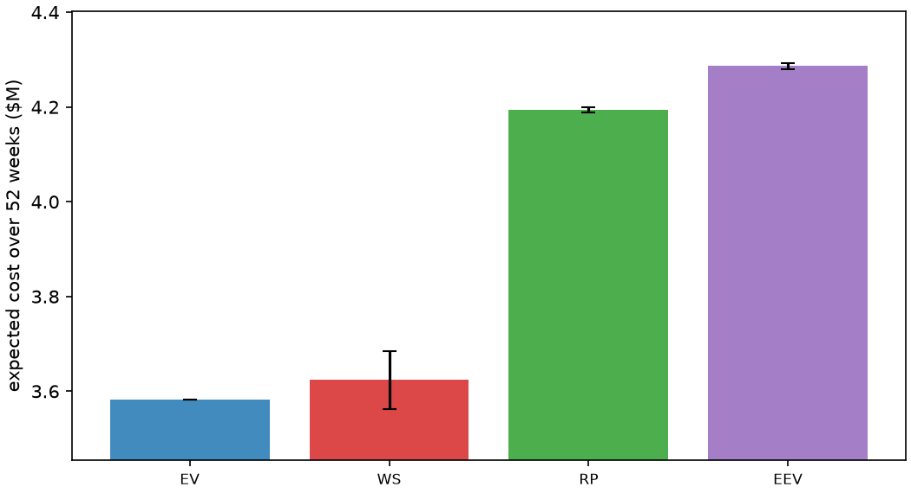
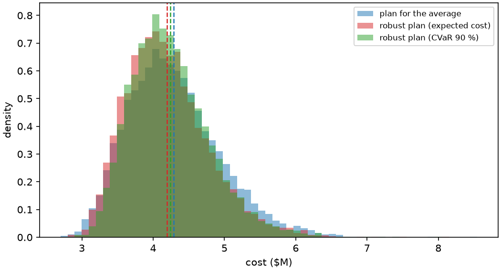
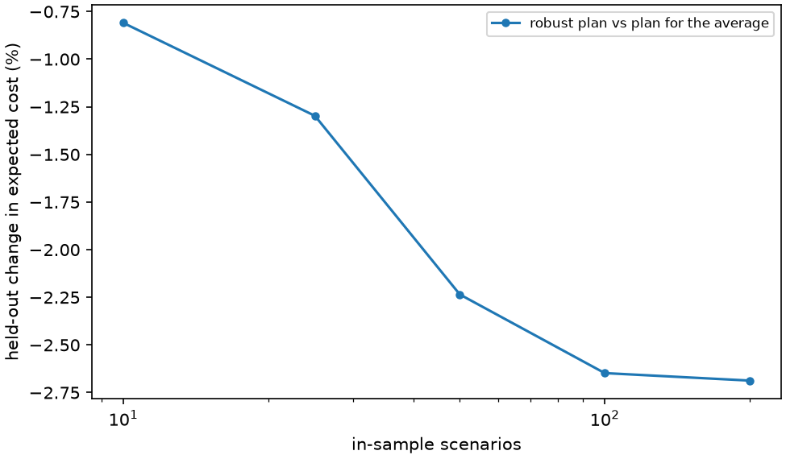
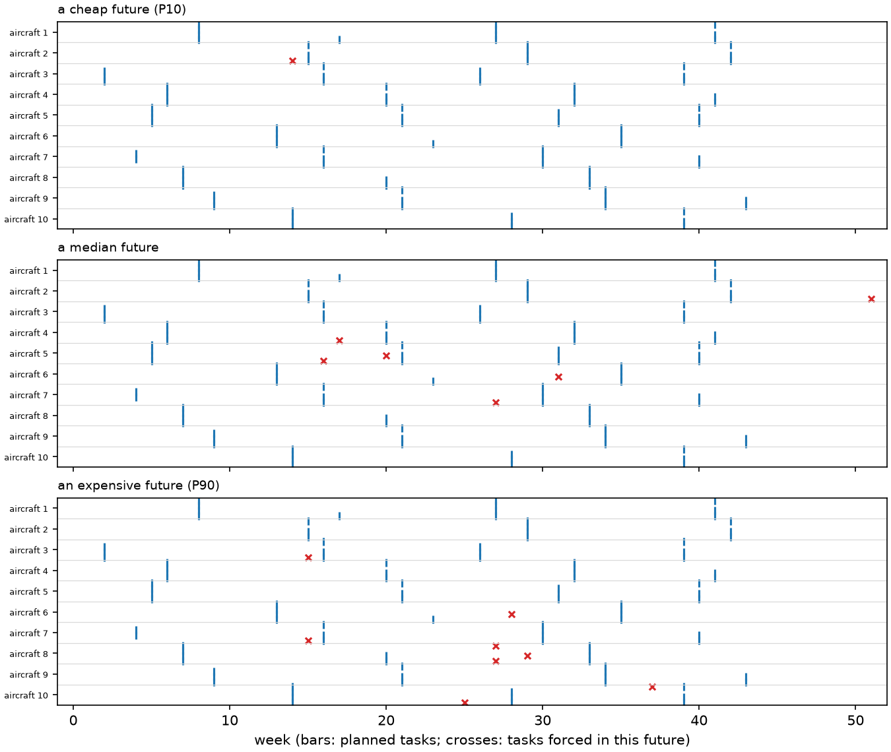

# Lesson 8 · The price of planning for the average

> Lesson 2 found that the plan for the average costs about 20 % more than it promises. This
> lesson finally explains where that 20 % goes, using four numbers that stochastic
> programming has used for decades: EV, WS, RP and EEV. The answer changes how to think about
> the whole problem. Variable flying is cheap if you know it in advance. What costs is not
> knowing. A plan made once can recover only a small part of that cost. Re-planning recovers
> much more.

**Code:** [`src/fracsched/tradeoff/`](../../src/fracsched/tradeoff/) ·
**Tests:** [`tests/test_tradeoff.py`](../../tests/test_tradeoff.py) ·
**Results:** [`validation/results/tradeoff.md`](../../validation/results/tradeoff.md) ·
**Previous:** [Lesson 7](07-uncertain-wear-on-top-of-uncertain-hours.md) ·
**Next:** [Lesson 9](09-what-is-and-isnt-new.md)

## Learning objectives

By the end of this lesson you should be able to:

1. Define EV, EEV, RP and WS, prove $\text{WS} \le \text{RP} \le \text{EEV}$, and define VSS and EVPI.
2. Decompose a deterministic plan's overrun into the cost of variability, the value of
   information and the value of the stochastic solution.
3. Bound a sample-average plan's optimality gap statistically (Mak-Morton-Wood).
4. Choose how many scenarios an SAA needs from a held-out curve.
5. Read cost distributions, not just means, when comparing plans.

---

## 1. Four numbers

Let $c(x, \omega)$ be the cost of plan $x$ in future $\omega$ (Birge & Louveaux, 2011, ch. 4):

```math
\begin{aligned}
\text{EV} &= \min_x c(x, \bar\omega) & &\text{the promise: the best plan for the average future } \bar\omega, \\
\text{EEV} &= E\left[c(x_{\text{EV}}, \omega)\right] & &\text{what that plan really costs}, \\
\text{RP} &= \min_x E\left[c(x, \omega)\right] & &\text{the best single plan (the recourse problem)}, \\
\text{WS} &= E\left[\min_x c(x, \omega)\right] & &\text{wait and see: the best plan for each future, known in advance}.
\end{aligned}
```

**The ordering.** For every $x$ and $\omega$, $\min_{x'} c(x', \omega) \le c(x, \omega)$. Taking
expectations and then the minimum over $x$ gives $\text{WS} \le \text{RP}$. And
$\text{RP} \le E[c(x_{\text{EV}}, \omega)] = \text{EEV}$, because $x_{\text{EV}}$ is one of the plans
RP minimises over. The two gaps have names:

```math
\text{EVPI} = \text{RP} - \text{WS} \ge 0, \qquad \text{VSS} = \text{EEV} - \text{RP} \ge 0 .
```

EVPI, the **expected value of perfect information**, is what a perfect forecast would be
worth. VSS, the **value of the stochastic solution**, is what planning against the futures
saves over planning for the average. On a common sample both inequalities hold exactly, and a
Hypothesis test checks them on random cost matrices.

**The overrun decomposes.** The deterministic plan's broken promise is

```math
\underbrace{\text{EEV} - \text{EV}}_{\text{overrun}} = \underbrace{(\text{WS} - \text{EV})}_{\text{cost of variability}} + \underbrace{(\text{RP} - \text{WS})}_{\text{EVPI}} + \underbrace{(\text{EEV} - \text{RP})}_{\text{VSS}} .
```

The first term is what variable flying would cost *even with perfect foresight*. The second is
the cost of not knowing. The third is the part of the cost of not knowing that a better
*single* plan removes.

## 2. Exact, on small instances

On AVR-04's five small instances every term can be computed exactly. EV, RP and each
wait-and-see problem are solved to proven optimality by CP-SAT on one thread. EEV and RP are
judged on 2000 held-out futures, WS on 100 of them ([results](../../validation/results/tradeoff.md),
\$k over 26 weeks):

| instance | EV | WS | RP | EEV | VSS | EVPI (paired) | overrun |
|---|---:|---:|---:|---:|---:|---:|---:|
| 0 | 353.8 | 344.3 | 403.5 | 421.2 | 17.7 ± 1.2 | 56.2 ± 4.3 | 19.1 % |
| 1 | 402.6 | 387.9 | 452.2 | 487.1 | 34.8 ± 1.5 | 59.0 ± 3.4 | 21.0 % |
| 2 | 392.8 | 381.5 | 447.8 | 464.4 | 16.6 ± 1.6 | 68.2 ± 3.9 | 18.2 % |
| 3 | 384.1 | 374.1 | 439.2 | 471.4 | 32.2 ± 1.7 | 65.6 ± 3.1 | 22.7 % |
| 4 | 422.1 | 402.4 | 464.7 | 481.4 | 16.7 ± 1.2 | 54.5 ± 3.3 | 14.0 % |

* **Perfect foresight beats the promise.** WS is 2.6 to 4.7 % *below* EV. Knowing each future
  exactly, the planner does better than in the average future: quiet years let it stretch
  intervals, and busy ones are met with tasks timed for them. Variability itself costs
  nothing here.
* **So the overrun is all ignorance.** With WS below EV, the whole overrun and more is EVPI:
  13 to 17 % of EV.
* **One good plan recovers a quarter to two fifths of it.** VSS is 4.0 to 8.6 % of EV, against
  an overrun of 14 to 23 %.

### Is the SAA plan close to the true optimum?

The RP plan above solves a 100-scenario sample, not the true distribution. Mak, Morton & Wood
(1999) bound its gap. The mean of $M = 10$ independent SAA optima estimates RP *from below*
(SAA is optimistic in expectation), and the plan's held-out mean estimates its true cost. The
difference, plus one-sided confidence terms, bounds the gap:

| instance | lower (10 SAA optima) | upper (held out) | gap estimate | 95 % bound |
|---|---:|---:|---:|---:|
| 0 | 401.6 ± 4.5 | 403.5 ± 2.5 | 1.9 | 3.52 % |
| 1 | 448.0 ± 2.4 | 452.2 ± 2.1 | 4.3 | 2.66 % |
| 2 | 441.5 ± 4.1 | 447.8 ± 2.1 | 6.3 | 3.86 % |
| 3 | 432.5 ± 3.2 | 439.2 ± 1.9 | 6.7 | 3.55 % |
| 4 | 454.3 ± 2.7 | 464.7 ± 2.1 | 10.3 | 4.02 % |

With 95 % confidence, a single 100-scenario SAA plan is within 2.7 to 4.0 % of the best
possible plan for the true distribution. Most of that width is Monte Carlo error in the
bound itself; the point estimates of the gap are 0.5 to 2.2 %.

## 3. On the main fleet

The GA cannot prove optimality on 40 components, so RP and WS are *upper* estimates: a better
optimiser could only lower them. WS is estimated with one GA run per future, on 48 futures.
On 10 000 held-out futures:

| measure | \$M over 52 weeks |
|---|---:|
| EV, the promise (AVR-04's plan at $\bar u$) | 3.582 |
| WS, perfect foresight (GA, 48 futures) | 3.623 ± 0.060 |
| RP, the best single plan (Lesson 3's GA plan) | 4.194 ± 0.006 |
| EEV, the plan for the average | 4.287 ± 0.006 |



The overrun of \$0.705M splits into \$0.041M of variability (WS − EV, within its error of
zero), \$0.571M of ignorance (RP − WS; \$0.512M ± 0.027 paired on the 48 futures) and
\$0.093M recovered by the robust plan (VSS). The robust plan recovers 13 % of the overrun.

Now set this beside Lesson 5. Re-planning every four weeks cut the realised cost by
\$0.39M on its own 48 years, more than half of the overrun. Re-planning works because it buys
the one thing the overrun is made of: information. Each re-plan knows four more weeks of the
truth.

### The whole distribution

| plan | mean | median | P90 | P99 | CVaR 90 % | worst |
|---|---:|---:|---:|---:|---:|---:|
| plan for the average | 4.287 | 4.215 | 5.148 | 6.109 | 5.567 | 8.545 |
| robust plan (expected cost) | 4.194 | 4.126 | 4.963 | 5.882 | 5.358 | 8.104 |
| robust plan (CVaR 90 %) | 4.240 | 4.175 | 4.963 | 5.847 | 5.339 | 8.036 |



The robust plans shift the whole distribution, not just the mean: P90 falls by \$0.19M and P99
by \$0.23 to 0.26M. The CVaR plan has the thinnest tail and pays \$0.046M of mean for it. Every
plan has a long right tail, with a worst year about twice the median: fast years are rare and
very expensive.

### How many scenarios does the SAA need?

| in-sample futures | held-out change vs the plan for the average |
|---:|---:|
| 10 | −0.035 ± 0.003 |
| 25 | −0.056 ± 0.003 |
| 50 | −0.096 ± 0.003 |
| 100 | −0.114 ± 0.003 |
| 200 | −0.116 ± 0.003 |



The gain grows quickly to about 100 futures and then flattens: 200 add nothing measurable.
Ten futures recover less than a third of it, because the optimiser fits their quirks
(Lesson 3's optimism). 100 was a reasonable choice, and the table shows it was not a lucky one.

### What a plan looks like in three futures



The planned tasks (bars) are the same in every panel; the forced tasks (crosses) are what each
future adds. The cheap future forces a single task; the expensive one forces several, spread
over most of the fleet. An [interactive version](../figures/tradeoff_gantt.html) is in the figures folder.

## 4. Worked example

*Two plans, two equally likely futures.* Plan A costs 1 in future 1 and 5 in future 2; plan B
costs 3 and 2. Plan A is the plan for the average, which promises EV = 1.5.

* EEV = mean of A = 3.0.
* RP = best mean = min(3.0, 2.5) = 2.5 (plan B).
* WS = mean of the best per future = (1 + 2)/2 = 1.5.
* VSS = 3.0 − 2.5 = 0.5; EVPI = 2.5 − 1.5 = 1.0; overrun = 3.0 − 1.5 = 1.5 =
  0 (variability) + 1.0 + 0.5.

This is the test `test_ladder_by_hand`. Note that WS equals EV here, as it nearly does in the
real instances: knowing the future would let you keep the promise.

## 5. Code walkthrough

```python
from fracsched.tradeoff import ladder_on_sample, mmw_gap, paired_difference

ladder = ladder_on_sample(costs, ev_plan=0, ev_value=ev)  # costs[plan, scenario]
print(ladder.vss, ladder.evpi, ladder.overrun)
bound = mmw_gap(saa_optima, held_out_costs)  # Mak-Morton-Wood
print(bound.gap, bound.bound, bound.relative_bound)
```

[`validation/tradeoff.py`](../../validation/tradeoff.py) builds the exact ladder with
`solve_saa`: a cost table with one scenario is the wait-and-see problem for that future.

## Exercises

1. Prove that WS ≤ EV whenever the cost is concave in $\omega$ for every plan, and that WS ≥ EV
   when the optimal value is convex in $\omega$. Which seems closer to this problem?
2. VSS on the main fleet is a *lower* estimate and EVPI an upper-or-lower one. Explain both.
3. Why is the Mak-Morton-Wood lower bound built from the *mean of SAA optima*, rather than
   from the SAA optimum of one large sample?
4. An operator can buy a utilization forecast that is perfect four weeks ahead and useless
   beyond. Using this lesson and Lesson 5, estimate what it is worth per year on the main
   fleet.
5. The worst future costs about twice the median for every plan. What would you add to the
   model to protect against it, other than a different objective?

### Solutions

1. If $c(x, \cdot)$ is concave for every $x$, then so is $\min_x c(x, \cdot)$, and Jensen gives
   $E[\min_x c(x, \omega)] \le \min_x c(x, \bar\omega)$, i.e. WS ≤ EV. If the optimal value is
   convex in $\omega$, the inequality reverses. Here WS < EV on every small instance, so the
   problem behaves more like the concave case: a planner who knows the future can exploit
   quiet years more than busy years hurt.
2. VSS = EEV − RP uses the GA's RP, an *upper* estimate of the true RP, so the true VSS is at
   least as large. EVPI = RP − WS uses two upper estimates, so its error can go either way. The
   small instances, where both are exact, are the reliable reference.
3. The expected SAA optimum is a lower bound on RP, but one sample gives a single draw with
   unknown error. Averaging $M$ independent optima gives an estimate *and* a standard error,
   so the bound has a confidence level.
4. Lesson 5's re-planning is exactly that: it acts on four-week-old truth, saving about
   \$0.39M a year against the plan for the average on its sample (about \$0.31M against the
   robust plan). That is an estimate of the forecast's value, up to a few hundred thousand
   dollars a year, before the costs of changing plans.
5. More flexibility where the tail comes from: extra hangar capacity that can be bought at short
   notice, spare-part buffers, or a rule that tasks within 10 % of their limit are always
   pulled into the next visit. All are recourse options the current model lacks; each would
   cut the cost of forced tasks in fast years.

## References

* J. R. Birge and F. Louveaux, *Introduction to Stochastic Programming*, 2nd ed., Springer,
  2011, ch. 4 (the value of information and of the stochastic solution).
* W. K. Mak, D. P. Morton and R. K. Wood, "Monte Carlo bounding techniques for determining
  solution quality in stochastic programs", *Operations Research Letters* 24(1–2), 1999,
  pp. 47–56.
* A. J. Kleywegt, A. Shapiro and T. Homem-de-Mello, "The sample average approximation method
  for stochastic discrete optimization", *SIAM Journal on Optimization* 12(2), 2002,
  pp. 479–502.
* J. R. Birge, "The value of the stochastic solution in stochastic linear programs with fixed
  recourse", *Mathematical Programming* 24, 1982, pp. 314–325.
